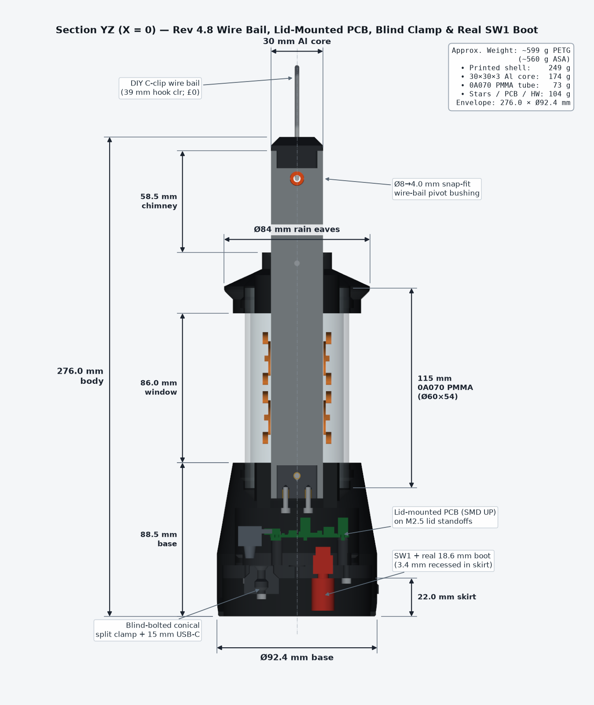
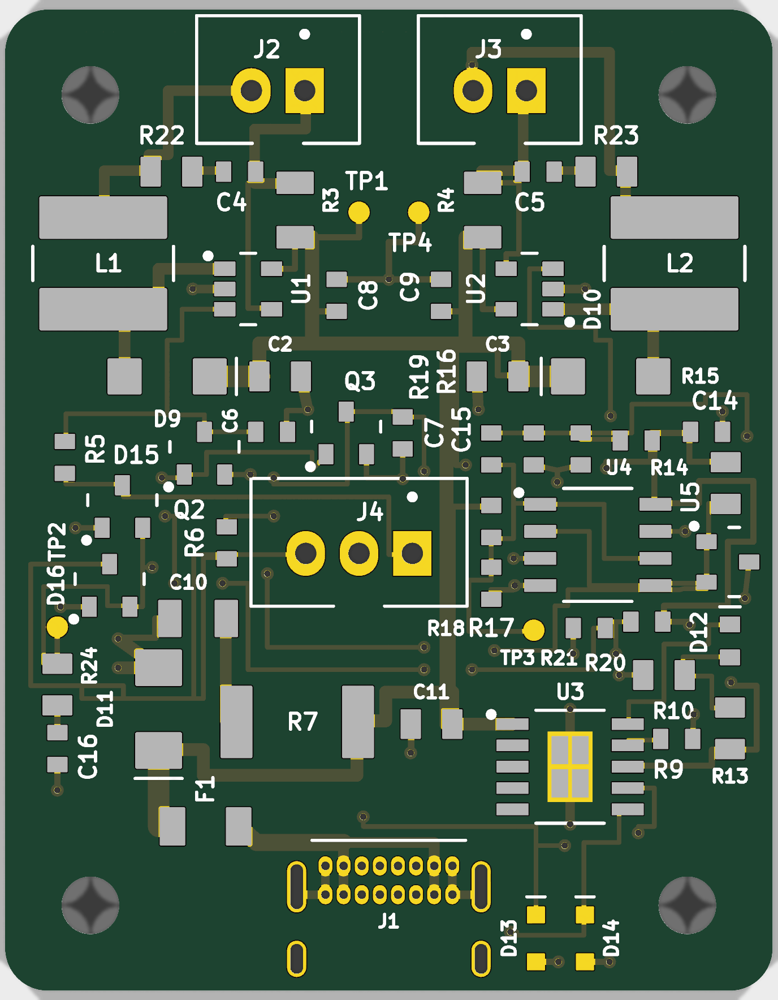

# LepiLED DIY Maxi Switch

**Open-source, fanless DIY moth lamp powered by 20 V USB-C PD**

*4× 365 nm UV-A · 2× 455 nm Royal Blue · 1× 528 nm Green · 1× 6200 K Cool White*

[Features](#key-features) · [Assembly](#whole-lamp-assembly) · [Driver PCB](#driver-pcb) · [Schematic](#circuit-schematic) · [Differences from Brehm (2017)](#differences-from-brehm-2017) · [Verification](#verification-summary) · [Build & Docs](#build--documentation)

---

An open-source DIY implementation of Gunnar Brehm's *LepiLED* moth lamp ([Brehm, 2017, *Nota Lepidopterologica* 40(1): 87–108](https://doi.org/10.3897/nl.40.11887)), designed for a low-hassle, weatherproof single-unit hobby build running from any 45 W+ USB-C PD laptop charger or 20 V USB-C PD power bank.

## Key Features

- **Insect-tuned 8-LED spectrum with balanced 360° layout:** Four 365 nm UV-A emitters and four visible emitters (`2×` Royal Blue on opposite `±X` faces, `1×` Green, `1×` Cool White) edge-clamped on two vertical tiers around a four-sided aluminum core, switched between `OFF`, `4-UV`, and `8-ALL` via a recessed gold-contact booted toggle (`C&K 7211SYZBE`).
- **Low-hassle 20 V USB-C PD electronics (zero home SMD soldering):** Single 2-layer **ENIG** `driver_pcb` (`36 × 46 mm`) ordered with **Full-SMD JLCPCB PCBA** (all `48` SMDs machine-reflowed; only `4` THT connectors `J1..J4` hand-soldered at home). Features `WCH CH224A` 20 V PD sink, `Littelfuse 046801.5NRHF` `1.5 A / 63 V` Slo-Blo fuse (`50 A` interrupt), `2512 1 W` pulse-rated hot-plug damper, `0.83 V` hysteretic UVLO (`LM393` + `TL431` with damped `R24/C16` ESD bypass), dual `AL8860WT-7` `333 mA` bucks (`94.1%` efficiency, `0.512 W` PCB loss), and bare ENIG bench test pads (`TP1..TP4`) + diagnostic LED `D12`.
- **Serviceable, weatherproof fanless lantern:** `driver_pcb` mounts **SMD/JST-side UP** on four integral `M2.5` brass-insert standoffs rising from `MECH-LID-BOT`, allowing open-air USB-C/JST mating and bench testing before sliding straight up into the `Ø71.6 mm` dry bay in one stroke. Sealed with radial silicone O-rings, an interior recessed IP68 ePTFE breather vent, blind-bolted conical split cable clamp, unbroken rain eaves + `9.5 mm` vertical chimney collar (`0` roof holes), PMMA-safe `OTTOSEAL® S 72 Clear`, and a chimney-only matte-black aluminum cooling core (`276.0 mm` tall, `~560 g` ASA / `~599 g` PETG).
- **Workshop-friendly & mistake-proofed:** Prints support-free on standard workshop **PETG or ASA** printers (`31.1 mm` core clearance, `0` supports), uses pre-mounted `20 mm` LED stars and pre-crimped JST-XH pigtails, and enforces full SSOT cross-domain verification via `python3 verify_all.py --check`.

## Whole Lamp Assembly

<table>
  <tr>
    <td align="center" width="50%">
      
       
      <b>3D Assembly (276.0 mm body / 317.3 mm w/ wire bail; ~560 g ASA / ~599 g PETG)</b> — Tapered PETG/ASA base with 22 mm protective skirt, PLEXIGLAS XT 0A070 acrylic shroud over 8 edge-clamped LED stars, sloped rain roof + 9.5 mm vertical collar (0 roof holes), chimney-only matte-black Al core, finial cap, snap-fit orange pivot bushings, and removable DIY coat-hanger C-clip wire bail.
    </td>
    <td align="center" width="50%">
      
       
      <b>YZ Cross-Section</b> — Staggered internal core anchor (±Y vertical bolts / ±X CSK cross-pins), radial shroud &amp; lid O-rings, serviceable lid-mounted PCB (SMD-side UP), 15 mm 90° USB-C plug + blind-bolted conical split clamp, and recessed real 18.6 mm SW1 toggle boot.
    </td>
  </tr>
</table>

## Driver PCB

<table>
  <tr>
    <td align="center" width="50%">
      
       
      <b>Driver PCB — Top (36 × 46 mm, 2-layer FR4, ENIG)</b> Full-SMD JLCPCB PCBA (48 SMDs: CH224A, 1206 Slo-Blo F1, 2512 R7, LM393/TL431 + R24/C16 UVLO, dual AL8860 bucks, TP1..TP4 bench pads) + 4 DIY THT headers.
    </td>
    <td align="center" width="50%">
      
       
      <b>Driver PCB — Bottom</b> Solid ground plane under the switching stage, Gerber-verified Ø5.6 mm NPTH copper keepouts around H1..H4, connector pinout legends, and Emperor-moth silkscreen.
    </td>
  </tr>
</table>

## Circuit Schematic

  
   
  Click to open the full vector <a href="circuit_design/schematic.pdf">schematic.pdf</a> (KiCad 10, 0 ERC violations).

## Differences from Brehm (2017)

Reference paper: **Brehm, G. (2017).** *A new LED lamp for the collection of nocturnal Lepidoptera and a spectral comparison of light-trapping lamps.* **Nota Lepidopterologica**, 40(1), 87–108. [doi:10.3897/nl.40.11887](https://doi.org/10.3897/nl.40.11887)

This build retains the paper's 8-LED spectrum (`4× UV-A`, `2× Royal Blue`, `1× Green`, `1× Cool White` on two tiers) and UV-transmitting `PLEXIGLAS® XT 0A070` acrylic shroud while making four practical changes for DIY builders:

- **Fanless passive cooling:** Replaces the internal cooling fan and mesh vents with a sealed acrylic cylinder and an exposed aluminum square tube core (top `58.5 mm` chimney sprayed matte black; interior left bare mill aluminum), paired with a sloped rain roof and an interior recessed IP68 ePTFE breather vent.
- **20 V USB-C PD buck electronics:** Replaces the low-voltage boost converter with a `CH224A` 20 V USB-C PD sink and two `AL8860WT-7` `333 mA` buck drivers (`94.1%` efficiency, `0.512 W` driver loss).
- **Recessed dual-mode switch:** Splits UV and visible LEDs onto independent channels selected via a weatherproof bottom-mounted gold-contact toggle (`OFF / 4-UV / 8-ALL`) with tactile `0 / 1 / 2` ribs on the base skirt.
- **Low-hassle DIY construction:** Uses pre-mounted `20 mm` LED stars, a single custom ENIG PCB with Full-SMD JLCPCB assembly (zero home SMD soldering), pre-crimped JST-XH wire pigtails, open-air lid-mounted PCB serviceability, and support-free PETG/ASA 3D-printed parts.

## Verification Summary

Run `python3 verify_all.py --check` at any time to verify all gates, SHA-256 freshness hashes, and doc parity:

| Domain | Scope | Result | Source |
|---|---|---|---|
| **Circuit & SPICE** | 6 `libngspice` benches (real TVS `TBV1`, `F1` `I²t`, `2512 R7` pulse), 2,565 corners, 2,000-trial MC | **16/16 PASS** (`0` corner failures, `100%` MC yield, `94.1%` eff, `107×` `F1` `I²t` margin) | [sim_summary.json](circuit_design/sim/outputs/sim_summary.json) |
| **Driver PCB & Gerbers** | KiCad 10 ERC, DRC (`--refill-zones --schematic-parity --severity-all`), RS-274X Gerber NPTH/DNP audit | **0 ERC, 0 DRC, 0 parity, 0 via-in-pad, 0 NPTH copper / DNP paste** | [driver_pcb.kicad_pcb](pcb_design/driver_pcb/driver_pcb.kicad_pcb) |
| **Thermal (SSOT-Coupled)** | Coupled steady-state model (`58.5 mm` chimney, `F_amb=0.88`, `14%` optical re-absorption, `P_PCB` from SPICE) | **24/24 PASS (`15–30 °C`)** (`T_j,UV = 61.8 °C` @ `22 °C`, `69.2–78.8 °C` @ `30 °C`; `T_bay <= 62.8 °C < 70 °C`) | [thermal_summary.json](mechanical_design/thermal/thermal_summary.json) |
| **Mechanical CAD** | 48 param checks, 8 watertight STLs, overhangs, **3 ray-cast breach gates**, 80 kinematic & 240 B-Rep pairs (incl. DIY wire bail, 14 brass inserts & exact-length screws) | **All PASS** (`0` collisions, `0` roof/wall breaches, `0` unsupported overhangs, `276.0 mm` body) | [cad_verification.json](mechanical_design/cad/cad_verification.json) |
| **Master BOM & Docs** | 1:1 parity across `72` RefDes, `54` PCBA, `23` `MECH-*`, all `Datasheet_Ref` files, SSOT drill coordinates | **PASS** (`£148.18` ex-VAT / `£177.82` inc-VAT parts-only; `~£226–£245` est. UK delivered) | [bom.csv](bom/bom.csv) |

<b>Additional Visuals — Thermal Plot, SPICE Waveforms &amp; Sealed Top Cap</b>

 

  
   
  Steady-state UV junction temperatures at 30 °C vertical hanging still air (with F_amb=0.88 rain-eave shading &amp; 14% optical re-absorption): chimney-only matte-black spray (Config 0) lowers UV junction temperature by 7–9 °C vs bare aluminum while keeping zero paint inside the 365 nm UV chamber.

<table>
  <tr>
    <td align="center" width="50%">
      
       
      <b>SPICE Modes</b> — Clean transitions across OFF, 4-UV, and 8-ALL at 333 mA per string.
    </td>
    <td align="center" width="50%">
      
       
      <b>Sealed Top Cap (0 Roof Holes)</b> — Unbroken Ø84 mm circular rain eaves lofted to a 9.5 mm vertical rounded-square chimney collar with backed OTTOSEAL S 72 channel.
    </td>
  </tr>
</table>

## Build & Documentation

| Area | Key Files |
|---|---|
| **Build Guides & Process** | [ASSEMBLY_GUIDE.md](docs/ASSEMBLY_GUIDE.md) · [BOM.md](bom/BOM.md) · [BLOCKERS.md](docs/BLOCKERS.md) *(pre-order checklist)* · [CHANGE_CHECKLIST.md](docs/CHANGE_CHECKLIST.md) *(SSOT & mistake-proofing)* · [DESIGN_DECISIONS.md](docs/DESIGN_DECISIONS.md) · [verify_all.py](verify_all.py) |
| **Electronics & SPICE** | [schematic.pdf](circuit_design/schematic.pdf) · [ELECTRONICS_ARCHITECTURE.md](docs/ELECTRONICS_ARCHITECTURE.md) · [COMPONENT_IDS.csv](circuit_design/COMPONENT_IDS.csv) · [INTERFACE_CONTRACT.md](circuit_design/INTERFACE_CONTRACT.md) · [run_simulations.py](circuit_design/sim/run_simulations.py) |
| **Driver PCB & PCBA** | [PCB_SUMMARY.md](pcb_design/PCB_SUMMARY.md) · [driver_pcb_gerbers.zip](pcb_design/gerbers/driver_pcb/driver_pcb_gerbers.zip) · [assembly_map.pdf](pcb_design/driver_pcb/renders/assembly_map.pdf) · Full-SMD ENIG PCBA: [driver_pcb_bom_pcba_hybrid.csv](pcb_design/driver_pcb_bom_pcba_hybrid.csv) + [driver_pcb_cpl_hybrid.csv](pcb_design/driver_pcb_cpl_hybrid.csv) + [driver_pcb_diy_hand_solder.csv](pcb_design/driver_pcb_diy_hand_solder.csv) |
| **3D Print & Mechanical** | [MECHANICAL_DESIGN.md](mechanical_design/MECHANICAL_DESIGN.md) · [CLEARANCE_VERIFICATION.md](mechanical_design/CLEARANCE_VERIFICATION.md) · [mech_cap_bot.step](mechanical_design/cad/mech_cap_bot.step) · [mech_lid_bot.step](mechanical_design/cad/mech_lid_bot.step) · [mech_cable_clamp.step](mechanical_design/cad/mech_cable_clamp.step) · [mech_core_anchor.step](mechanical_design/cad/mech_core_anchor.step) · [mech_cap_top.step](mechanical_design/cad/mech_cap_top.step) · [mech_plug_top.step](mechanical_design/cad/mech_plug_top.step) · [mech_hang_bushing.step](mechanical_design/cad/mech_hang_bushing.step) · [mech_drill_jig.step](mechanical_design/cad/mech_drill_jig.step) · [lepiled_assembly.step](mechanical_design/cad/lepiled_assembly.step) |
| **Parts Data & Datasheets** | [bom.csv](bom/bom.csv) · [MECH_PARTS.csv](mechanical_design/MECH_PARTS.csv) · [datasheets_summary.md](datasheets/datasheets_summary.md) |
