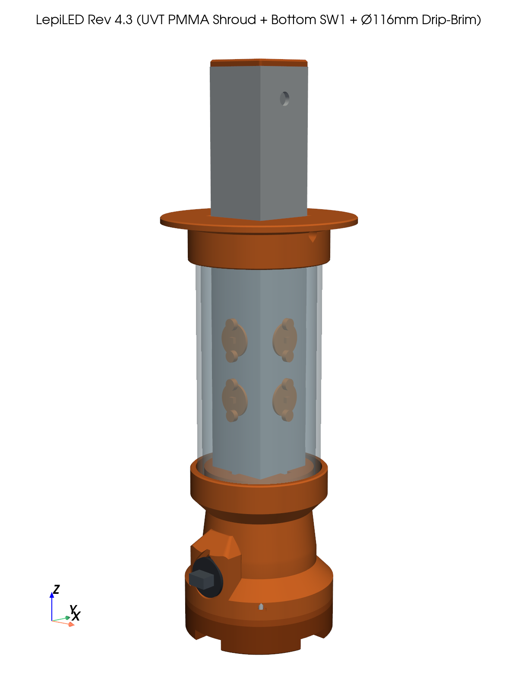
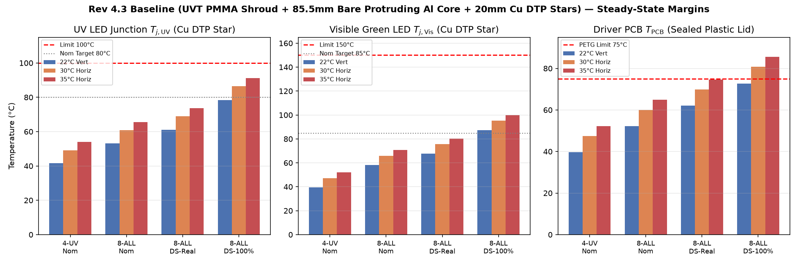

# LepiLED DIY Maxi Switch

**Open-source, fanless DIY moth lamp — `20 V` USB-C PD + dual buck drivers + `20 mm` Copper DTP LED stars**

*4× 365 nm UV-A · 2× 455 nm Royal Blue · 1× 528 nm Green · 1× 6200 K Cool White*

[Lamp Assembly](#whole-lamp-assembly) · [Driver PCB](#driver-pcb) · [Circuit Schematic](#circuit-schematic) · [Differences from Brehm (2017)](#differences-from-brehm-2017) · [Verification](#verification-summary) · [Build & BOM](#build--repository-map)

---

An open-source DIY implementation of Gunnar Brehm's *LepiLED* moth lamp ([Brehm, 2017, *Nota Lepidopterologica* 40(1): 87–108](https://doi.org/10.3897/nl.40.11887)), engineered for a rugged, weatherproof, portable single-unit hobby build running straight off any `45 W+` USB-C PD laptop charger or `20 V` USB-C PD power bank. **Rev 4.3** pairs **pre-mounted `20 mm` Copper DTP LED stars** (zero bare-LED reflow, single custom PCB), a **shatter-resistant UV-transmitting PMMA (acrylic) shroud** (`120 g`, `85–92%` @ `365 nm`), a **single stock `250 mm` bare `40 × 40 × 3 mm` aluminum core** protruding `85.5 mm` out the top with an unobstructed `Ø8 mm` hanging hole, a **bottom-mounted toggle switch inside a bolt-on protective standing ring**, an **integral `Ø116 mm` rain drip-brim with underside drip-break groove** at the top of the shroud, and a **contoured lightweight lower housing** (`~862 g` FDM)—bringing the complete **1-off UK build to `£91.35` ex-VAT (`£109.62` inc-VAT; `£101.76` inc-VAT with workshop `M3` hardware & PC thermal paste)**.

## Whole Lamp Assembly

<table>
  <tr>
    <td align="center" width="50%">
      
       
      <b>3D Assembly (345 mm tall; ~862 g FDM)</b> — Shatter-resistant UVT PMMA cylinder, bare stock 250 mm 40×40×3 mm Al core protruding 85.5 mm with unobstructed Ø8 mm hang hole &amp; rain plug, integral Ø116 mm drip-brim with underside drip groove, contoured lower shell (solid +X wall), and protective base stand ring.
    </td>
    <td align="center" width="50%">
      
       
      <b>YZ Cross-Section</b> — Unobstructed Ø8 mm hang hole &amp; press-fit rain plug, Ø116 mm drip-brim, 8× 20 mm Copper DTP stars, 6.0 mm bulkhead, printed bottom core plug, integral PCB locating pins, direct-mate USB-C grommet boss, and downward-pointing booted DPDT switch shielded inside the base stand ring.
    </td>
  </tr>
</table>

## Driver PCB

<table>
  <tr>
    <td align="center" width="50%">
      
       
      <b>Driver PCB — Top (36 × 46 mm, 2L FR4 ENIG, JLCPCB Basic-Optimized PCBA)</b> AP33771C 20 V PD sink, 40 V DMN4035L load switch, hysteretic LM393B UVLO, dual AL8860WT-7 333 mA bucks.
    </td>
    <td align="center" width="50%">
      
       
      <b>Driver PCB — Bottom</b> Unbroken <code>B.Cu</code> power-stage GND plane, isolated NPTH holes dropping onto printed bottom-lid locating pins, mirrored pinout legends.
    </td>
  </tr>
</table>

## Circuit Schematic

  
   
  Click the schematic to open the full vector <a href="circuit_design/schematic.pdf">schematic.pdf</a> (KiCad 9.0.8, 0 ERC violations, 75 unique RefDes).

## Differences from Brehm (2017)

Reference paper: **Brehm, G. (2017).** *A new LED lamp for the collection of nocturnal Lepidoptera and a spectral comparison of light-trapping lamps.* **Nota Lepidopterologica**, 40(1), 87–108. [doi:10.3897/nl.40.11887](https://doi.org/10.3897/nl.40.11887)

This DIY build retains the paper's 8-LED insect-tuned spectrum (`4× UV-A`, `2× Royal Blue`, `1× Green`, `1× Cool White` at two vertical levels) and UV-transmitting acrylic (`PMMA`) cylinder while making four practical departures from the 2017 prototype:

- **Fanless monolithic cooling + shroud drip-brim:** Replaces the internal axial fan and gauze vents with a sealed UV-transmitting PMMA cylinder (`Ø75 × 3.0 mm`), a single stock `250 mm` `40 × 40 × 3 mm` bare aluminum tube protruding `85.5 mm` out the top (unobstructed `Ø8 mm` hanging hole + silicone-sealed rain plug), and an integral `Ø116 mm` top drip-brim with an underside drip-break groove.
- **`20 V` USB-C PD + dual buck drivers:** Replaces the `5–12 V` boost constant-current source with a `20 V` USB-C PD sink (`AP33771C`) and two `AL8860WT-7` constant-current buck drivers (`333 mA` per channel, `93.8%` efficiency), running straight off standard laptop chargers or `20 V` PD power banks.
- **Protected bottom-mounted dual-mode switch (`OFF / 4-UV / 8-ALL`):** Splits the 8 LEDs into independent 4S UV-A and 4S Visible strings controlled by a booted gold-contact `DPDT` toggle mounted underneath `MECH-LID-BOT` inside a drained standing ring (`MECH-BASE-RING`)—keeping water away from the switch while letting the lamp stand safely upright.
- **Zero bare-SMD soldering & single-fastener DIY build:** Uses off-the-shelf pre-mounted `20 mm` Copper DTP LED stars (`R_sub ≈ 0.5 K/W`), JLCPCB-assemblable `driver_pcb`, pre-crimped `22 AWG` JST-XH pigtails, 7 support-free 3D-printed FDM parts with captive `M3` hex-nut pockets, and `M3` as the sole fastener size across the entire lamp.

## Verification Summary

| Domain | Verification Suite | Result | Report / Source |
|---|---|---|---|
| **Circuit & SPICE** | 6 `ngspice` benches + `2,565` datasheet corners + `2,000`-trial Monte Carlo | **15/15 PASS** (`0` corner fails, `100.0%` MC yield, `0` UVLO chatter) | [sim_summary.json](circuit_design/sim/outputs/sim_summary.json) |
| **Driver PCB** | KiCad 9.0.8 real-pin ERC + DRC (`--schematic-parity --severity-all`) + copper audits | **0 ERC, 0 DRC, 0 parity, 0 via-in-pad, 0 `B.Cu` power slots** | [driver_pcb.kicad_pcb](pcb_design/driver_pcb/driver_pcb.kicad_pcb) |
| **Thermal (Rev 4.3)** | Coupled network: UVT PMMA (`k=0.19`) + `85.5 mm` bare core + Cu DTP stars + sealed lid | **16/16 Real-WPE PASS** (`22–30 °C`) + **4/4** (`35 °C`) + **10/10** (`22 °C`); `T_shroud <= 46 °C` | [thermal_summary.json](mechanical_design/thermal/thermal_summary.json) |
| **Mechanical CAD** | `45` param checks + `7` watertight FDM STLs + `3,363`-ray flange check + `182` B-Rep pairs | **ALL PASS** (`0/182` collisions Nom/WC, `0.000–0.787 mm²` `>46°` overhangs, `~862 g` FDM) | [cad_verification.json](mechanical_design/cad/cad_verification.json) |
| **UK 1-Off BOM** | 1:1 RefDes (`75`) / PCBA (`61`) / Pigtails (`2`) / PCB (`1`) / Mech (`15`) parity | **PASS** (`£91.35` ex-VAT / `£109.62` inc-VAT 1-off; `£101.76` w/ owned M3 & paste) | [bom.csv](bom/bom.csv) |

<b>More Visuals — Thermal Margins, SPICE Waveforms &amp; 3D-Printed Parts</b>

 

  
   
  Coupled steady-state junction and PCB temperatures across 22 °C, 30 °C, and 35 °C ambient with UVT PMMA shroud, bare protruding Al core, and 20 mm Copper DTP stars.

<table>
  <tr>
    <td align="center" width="50%">
      
       
      <b>SPICE Modes</b> — Clean transitions across OFF, 4-UV, and 8-ALL at 333 mA.
    </td>
    <td align="center" width="50%">
      
       
      <b>Support-Free Top Cap</b> — Integral Ø116 mm rain drip-brim with 1.5 mm underside drip-break groove shielding the 2× M3 core locking screws (0.00 mm² overhang inverted).
    </td>
  </tr>
</table>

## Build & Repository Map

| Area | Key Files |
|---|---|
| **Start Here** | [ASSEMBLY_GUIDE.md](docs/ASSEMBLY_GUIDE.md) · [BOM.md](bom/BOM.md) · [DESIGN_DECISIONS.md](docs/DESIGN_DECISIONS.md) · [BLOCKERS.md](docs/BLOCKERS.md) |
| **Electronics & SPICE** | [schematic.pdf](circuit_design/schematic.pdf) · [ELECTRONICS_ARCHITECTURE.md](docs/ELECTRONICS_ARCHITECTURE.md) · [COMPONENT_IDS.csv](circuit_design/COMPONENT_IDS.csv) · [INTERFACE_CONTRACT.md](circuit_design/INTERFACE_CONTRACT.md) · [run_simulations.py](circuit_design/sim/run_simulations.py) |
| **Driver PCB & PCBA** | [PCB_SUMMARY.md](pcb_design/PCB_SUMMARY.md) · [driver_pcb_gerbers.zip](pcb_design/gerbers/driver_pcb/driver_pcb_gerbers.zip) · [assembly_map.pdf](pcb_design/driver_pcb/renders/assembly_map.pdf) · [driver_pcb_bom_pcba.csv](pcb_design/driver_pcb_bom_pcba.csv) · [driver_pcb_cpl.csv](pcb_design/driver_pcb_cpl.csv) |
| **3D Print & Mechanical** | [MECHANICAL_DESIGN.md](mechanical_design/MECHANICAL_DESIGN.md) · [CLEARANCE_VERIFICATION.md](mechanical_design/CLEARANCE_VERIFICATION.md) · [mech_base_ring.step](mechanical_design/cad/mech_base_ring.step) · [mech_lid_bot.step](mechanical_design/cad/mech_lid_bot.step) · [mech_cap_bot.step](mechanical_design/cad/mech_cap_bot.step) · [mech_cap_top.step](mechanical_design/cad/mech_cap_top.step) · [mech_plug_top.step](mechanical_design/cad/mech_plug_top.step) · [mech_plug_bot.step](mechanical_design/cad/mech_plug_bot.step) · [mech_drill_jig.step](mechanical_design/cad/mech_drill_jig.step) · [lepiled_assembly.step](mechanical_design/cad/lepiled_assembly.step) |
| **Datasheets & BOM** | [bom.csv](bom/bom.csv) · [MECH_PARTS.csv](mechanical_design/MECH_PARTS.csv) · [datasheets_summary.md](datasheets/datasheets_summary.md) |
