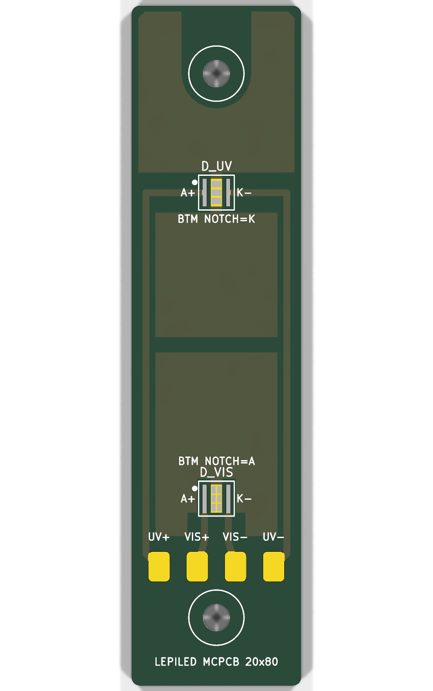
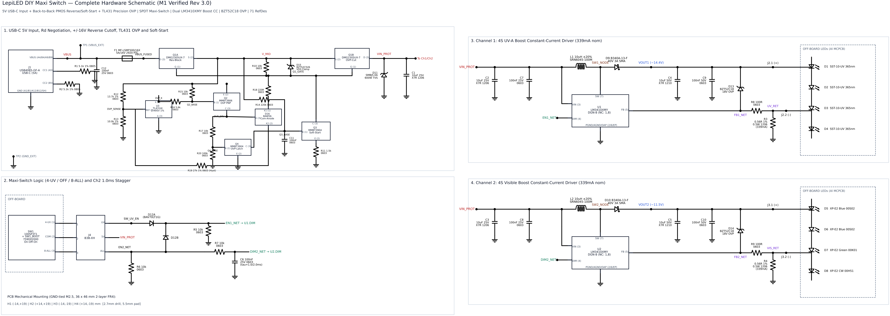
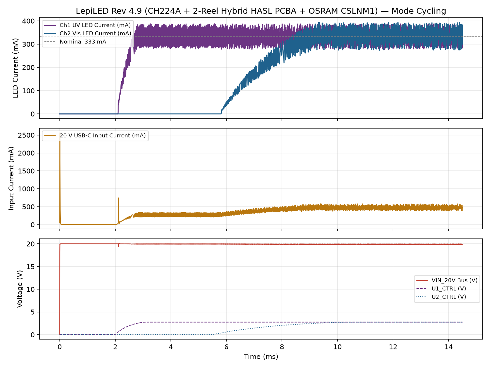
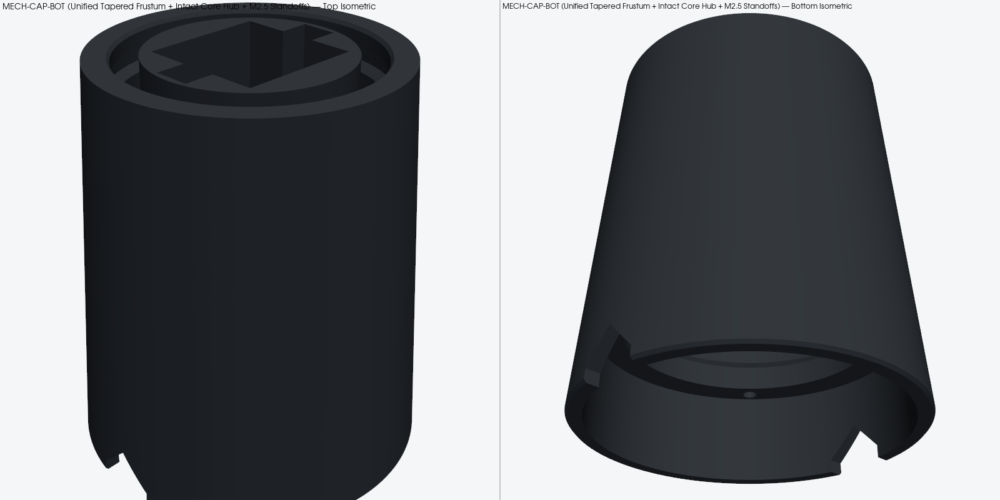

# LepiLED DIY Maxi Switch

**Open-source, fanless DIY moth lamp — `20 V` USB-C PD + dual constant-current buck LED drivers**

*4× 365 nm UV-A · 2× 455 nm Royal Blue · 1× 528 nm Green · 1× 6200 K Cool White*

[Lamp Assembly](#whole-lamp-assembly) · [Custom PCBs](#custom-pcbs) · [Circuit Schematic](#circuit-schematic) · [Architecture](#architecture-highlights) · [Verification](#verification-summary) · [Build & BOM](#build--repository-map)

---

An open-source DIY implementation of Gunnar Brehm's *LepiLED* moth lamp ([Brehm, 2017, *Nota Lepidopterologica* 40(1): 87–108](https://doi.org/10.3897/nl.40.11887)), engineered to run directly from any standard `45 W+` USB-C PD laptop charger or `20 V` USB-C PD power bank. With only **`0.55 W`** nominal driver PCB heat loss, the lamp runs fanless on a single top heatsink (`288 mm` tall), uses off-the-shelf aluminum bar/disc stock with **zero CNC milling**, prints support-free on a standard FDM printer, and comes in under **`£100` ex-VAT** amortized for all UK-sourced lamp parts.

## Whole Lamp Assembly

<table>
  <tr>
    <td align="center" width="50%">
      
       
      <b>3D Assembly (288 mm tall)</b> — Borosilicate 3.3 cylinder, matte-black 40×40 mm Al core, 4× Al MCPCB strips, top SK 578/50 SA heatsink, 20 mm USB-C rubber grommet, and booted DPDT toggle.
    </td>
    <td align="center" width="50%">
      
       
      <b>YZ Cross-Section</b> — Metal-to-metal M6 eye-bolt hanging path with 0.50 mm top anchor preload, 6.0 mm thermal bulkhead, integral bottom-lid PCB bosses, and direct-mate USB-C tunnel.
    </td>
  </tr>
</table>

## Custom PCBs

<table>
  <tr>
    <td align="center" width="38%">
      
       
      <b>Driver PCB — Top (36 × 46 mm, 2L FR4 ENIG)</b> AP33771C PD sink, 40 V DMN4035L load switch, hysteretic LM393B UVLO, dual AL8860WT-7 333 mA bucks.
    </td>
    <td align="center" width="38%">
      
       
      <b>Driver PCB — Bottom</b> Unbroken <code>B.Cu</code> power-stage GND plane, isolated unplated M2.5 NPTH mounts, mirrored connector legends.
    </td>
    <td align="center" width="24%">
      
       
      <b>LED MCPCB Strip (4×, 20 × 80 mm)</b> 1-layer Al ENIG (1.0 W/m·K), segmented paste stencils, opposite-notch polarity legends.
    </td>
  </tr>
</table>

## Circuit Schematic

  
   
  Click the schematic to open the full vector <a href="circuit_design/schematic.pdf">schematic.pdf</a> (KiCad 9.0.8, 0 ERC violations, 75 unique RefDes).

## Differences from Brehm (2017)

Reference paper: **Brehm, G. (2017).** *A new LED lamp for the collection of nocturnal Lepidoptera and a spectral comparison of light-trapping lamps.* **Nota Lepidopterologica**, 40(1), 87–108. [doi:10.3897/nl.40.11887](https://doi.org/10.3897/nl.40.11887)

This DIY build retains the paper's 8-LED insect-tuned spectrum (`4× UV-A`, `2× Royal Blue`, `1× Green`, `1× Cool White` at two vertical levels) while making four practical departures from the 2017 prototype:

- **Fanless passive cooling:** Replaces the internal axial fan and gauze vents with a sealed, zero-moving-parts thermal path (borosilicate 3.3 cylinder, matte-black aluminum core, and top `SK 578/50 SA` radial heatsink).
- **`20 V` USB-C PD + dual buck drivers:** Replaces the `5–12 V` boost constant-current source with a `20 V` USB-C PD sink (`AP33771C`) and two `AL8860WT-7` constant-current buck drivers (`333 mA` per channel, `93.8%` efficiency), eliminating high-current cable droop and running straight off modern laptop chargers or `20 V` PD power banks.
- **Dual-mode switching (`OFF / 4-UV / 8-ALL`):** Splits the 8 LEDs into independent 4S UV-A and 4S Visible channels controlled by a sealed gold-contact `DPDT` toggle (matching Brehm's later *Maxi Switch* functionality, vs. single-mode operation in the 2017 prototype).
- **Current emitters & zero-CNC DIY build:** Uses stocked `Luminus SST-10-UV` (`365 nm`) and `Cree XP-E2` LEDs on custom 1-layer aluminum MCPCB strips, support-free 3D-printed end caps, and off-the-shelf aluminum bar/disc hardware.

## Architecture Highlights

- **USB-C PD 3.1 Power Entry (`20 V / 1.0 A`):** `Diodes AP33771C` negotiates `20 V` over a `GCT USB4085-GF-A` receptacle (`J1`), protected by a `33 V` `Bourns MF-MSMF110/33X` PTC polyfuse (`F1`), zero-stub unidirectional `SMBJ22A` TVS (`D11`), `24 V` `CC1`/`CC2` ESD clamps (`D13`/`D14`), a `6.7 µF` RC hot-plug damper (clamping `85 °C / 1.0 µH` transients to `26.02 V`), and a single slew-controlled `40 V` `DMN4035L-7` load switch (`Q1`, `0.582 A` peak inrush).
- **Dual Constant-Current Buck LED Drivers (`333 mA`):** Two `Diodes AL8860WT-7` hysteretic buck drivers (`U1`, `U2`) with Kelvin-sensed `0.30 Ω` resistors (`R3`/`R4`), `68 µH` shielded inductors (`L1`/`L2`, `2.46×` `I_sat` margin), and damped `100 nF + 6.8 Ω` output shunts (`C4/R22`, `C5/R23`) drive the 4S UV-A string (`J2`) and 4S Visible string (`J3`) at `93.8%` overall efficiency.
- **Hysteretic Hardware UVLO & Gold Dry-Circuit Switch:** Dual `TI LM393B` comparator (`U4`) + `LM4040-2.5` reference (`U5`) rejects non-20V USB chargers (`5/9/12/15 V`) with `0.90 V` positive-feedback hysteresis (`V_ON = 17.54 V`, `V_OFF = 16.64 V`, zero chatter). A gold-contact `C&K 7211SYZBE` `DPDT On-On-On` toggle (`SW1`, `OFF / 4-UV / 8-ALL`) with waterproof silicone boot wires directly to `J4` through `1.0 kΩ` resistors and `5 V` ESD clamps (`D15`/`D16`).
- **Zero-CNC Fanless Enclosure & Dew Protection:** A `75/68/3.5 × 150 mm` borosilicate 3.3 tube surrounds a matte-black `40 × 40 × 3 mm` aluminum core and single top `Fischer SK 578/50 SA` heatsink bridged by stock `Ø76.2 × 3 mm` Al disc and `32 × 32 mm` Al bar anchors. A 3D-printed bottom lid (`MECH-LID-BOT`) mounts `driver_pcb` on nylon `M2.5` screws, while a `£0.30` off-the-shelf `20 mm` slit rubber membrane grommet and acrylic conformal coating guard against garden dew.

## Verification Summary

| Domain | Verification Suite | Result | Report / Source |
|---|---|---|---|
| **Circuit & SPICE** | 6 `ngspice` benches + `2,565` datasheet corners + `2,000`-trial Monte Carlo | **15/15 PASS** (`0` corner fails, `100.0%` MC yield, `0` UVLO chatter) | [sim_summary.json](circuit_design/sim/outputs/sim_summary.json) |
| **Driver PCB** | KiCad 9.0.8 real-pin ERC + DRC (`--schematic-parity --severity-all`) + copper audits | **0 ERC, 0 DRC, 0 parity, 0 via-in-pad, 0 `B.Cu` power slots** | [driver_pcb.kicad_pcb](pcb_design/driver_pcb/driver_pcb.kicad_pcb) |
| **LED MCPCB** | KiCad 9.0.8 native ERC + DRC (`--schematic-parity --severity-all`) + 1L Al `.gbrjob` | **0 ERC, 0 DRC, 0 unconnected, 0 parity** | [led_mcpcb.kicad_pcb](pcb_design/led_mcpcb/led_mcpcb.kicad_pcb) |
| **Thermal (2D/3D FVM)** | Coupled 2D MCPCB + 3D Driver PCB + Top `SK 578/50 SA` / Sealed Lid (`75 °C` PETG) | **20/20 PASS** (`22–30 °C`) + **5/5 PASS** (`35 °C`) + **4/4 real-WPE** (`40 °C`) | [thermal_summary.json](mechanical_design/thermal/thermal_summary.json) |
| **Mechanical CAD** | `35` param checks + watertight STLs + `3,249`-ray flange check + `272` B-Rep pairs | **ALL PASS** (`0/272` collisions Nom/WC, `0.000 mm³` kinematic sweeps) | [cad_verification.json](mechanical_design/cad/cad_verification.json) |
| **UK GBP BOM** | 1:1 RefDes (`75`) / PCBA (`61`) / Harness (`3`) / Mechanical (`27`) parity check | **PASS** (`£98.49` ex-VAT / `£118.19` inc-VAT amort; `£147.09` 1-off) | [bom.csv](bom/bom.csv) |

<b>More Visuals — Thermal Margins, SPICE Waveforms &amp; 3D-Printed Bottom Cap Detail</b>

 

  
   
  Coupled 2D/3D FVM steady-state junction and PCB temperatures across 22 °C, 30 °C, and 35 °C ambient.

<table>
  <tr>
    <td align="center" width="50%">
      
       
      <b>SPICE Modes</b> — Clean transitions across OFF, 4-UV, and 8-ALL at 333 mA.
    </td>
    <td align="center" width="50%">
      
       
      <b>Support-Free Bottom Cap</b> — 20 mm rubber grommet flange &amp; DPDT switch alcove.
    </td>
  </tr>
</table>

## Build & Repository Map

| Area | Key Files |
|---|---|
| **Start Here** | [ASSEMBLY_GUIDE.md](docs/ASSEMBLY_GUIDE.md) · [BOM.md](bom/BOM.md) · [DESIGN_DECISIONS.md](docs/DESIGN_DECISIONS.md) · [BLOCKERS.md](docs/BLOCKERS.md) |
| **Electronics & SPICE** | [schematic.pdf](circuit_design/schematic.pdf) · [ELECTRONICS_ARCHITECTURE.md](docs/ELECTRONICS_ARCHITECTURE.md) · [COMPONENT_IDS.csv](circuit_design/COMPONENT_IDS.csv) · [INTERFACE_CONTRACT.md](circuit_design/INTERFACE_CONTRACT.md) · [run_simulations.py](circuit_design/sim/run_simulations.py) |
| **PCBs & Fabrication** | [PCB_SUMMARY.md](pcb_design/PCB_SUMMARY.md) · [driver_pcb_gerbers.zip](pcb_design/gerbers/driver_pcb/driver_pcb_gerbers.zip) · [led_mcpcb_gerbers.zip](pcb_design/gerbers/led_mcpcb/led_mcpcb_gerbers.zip) · [assembly_map.pdf](pcb_design/driver_pcb/renders/assembly_map.pdf) · [driver_pcb_cpl.csv](pcb_design/driver_pcb_cpl.csv) |
| **3D Print & Mechanical** | [MECHANICAL_DESIGN.md](mechanical_design/MECHANICAL_DESIGN.md) · [CLEARANCE_VERIFICATION.md](mechanical_design/CLEARANCE_VERIFICATION.md) · [mech_lid_bot.step](mechanical_design/cad/mech_lid_bot.step) · [mech_cap_bot.step](mechanical_design/cad/mech_cap_bot.step) · [mech_cap_top.step](mechanical_design/cad/mech_cap_top.step) · [lepiled_assembly.step](mechanical_design/cad/lepiled_assembly.step) |
| **Datasheets & BOM** | [bom.csv](bom/bom.csv) · [MECH_PARTS.csv](mechanical_design/MECH_PARTS.csv) · [datasheets_summary.md](datasheets/datasheets_summary.md) |
