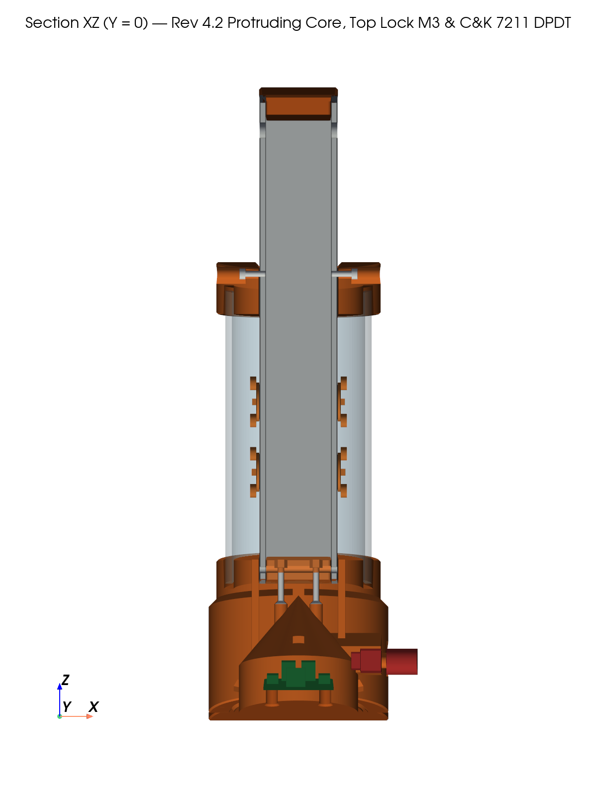
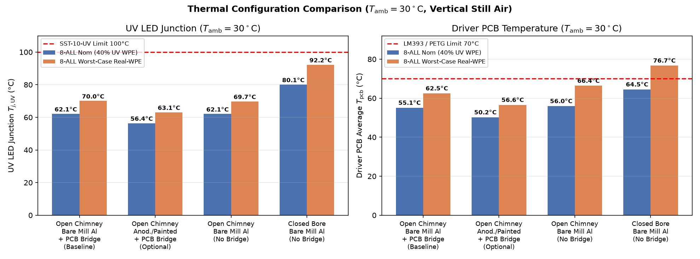
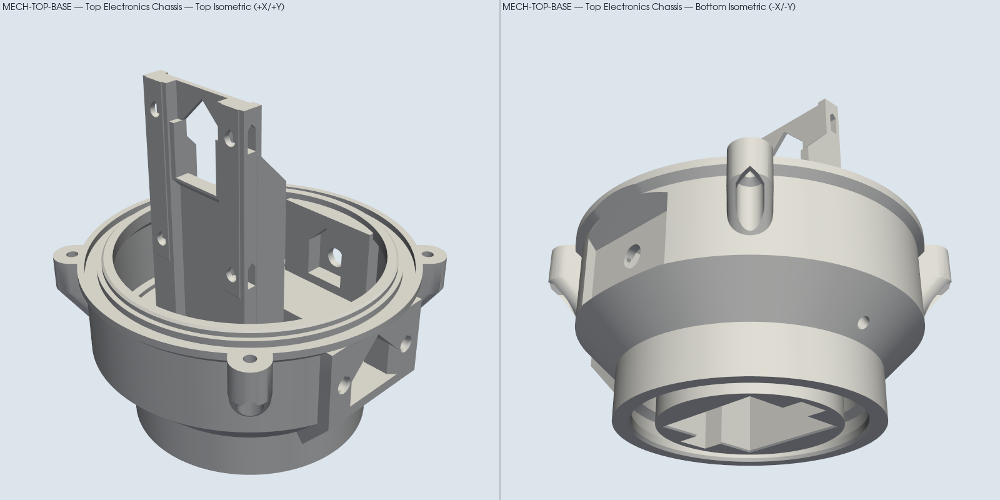
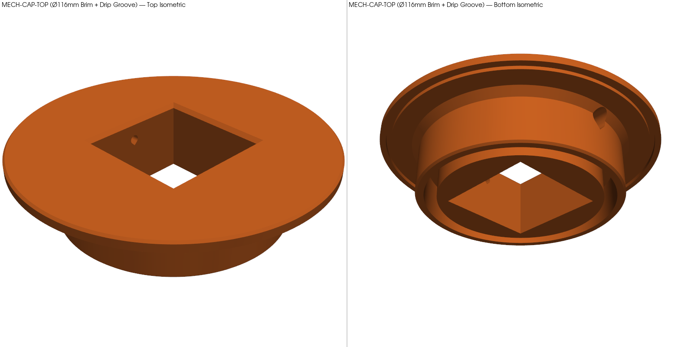

# LepiLED DIY Maxi Switch

**Open-source, fanless DIY moth lamp powered by 20 V USB-C PD**

*4× 365 nm UV-A · 2× 455 nm Royal Blue · 1× Pure Green · 1× 6500 K Cool White*

-orange?style=flat-square)

[Features](#key-features) · [Assembly](#whole-lamp-assembly) · [Driver PCB](#driver-pcb) · [Schematic](#circuit-schematic) · [Differences from Brehm (2017)](#differences-from-brehm-2017) · [Verification](#verification-summary) · [Build & Docs](#build--documentation)

---

An open-source DIY implementation of Gunnar Brehm's *LepiLED* moth lamp ([Brehm, 2017, *Nota Lepidopterologica* 40(1): 87–108](https://doi.org/10.3897/nl.40.11887)), designed for unattended funnel traps and open-sheet moth trapping. Powered from any 45 W+ USB-C PD laptop charger or 20 V USB-C PD power bank.

## Key Features

- **Funnel-trap geometry with open-chimney passive cooling:** All electronics, the mode switch, and the cable exit live in the top white umbrella head, leaving a compact tapered bottom nosecone (`Ø40 → Ø71 × 34.0 mm`) with no bottom cable. The hollow `30 × 30 × 2.0 mm × 300.0 mm` bare mill-finish aluminum core (`ε_IR ≈ 0.10`) runs as an open, unobstructed natural-draft chimney from the nosecone tip to a ventilated overhanging rain finial, keeping UV junctions at `54.2–62.1 °C` (`22–30 °C` nominal) and allowing rainwater in the bore to drain straight through without touching either sealed chamber.
- **Zero aluminum tapping & simple workshop build:** All eight `20 mm` Copper DTP LED stars bond directly to abraded aluminum landing pads with 2-part thermally conductive epoxy, eliminating 16 tapped holes and all core-to-shroud leak paths. The entire aluminum core requires only `4` plain `Ø4.5 mm` clearance holes (`2` bottom, `2` top) located with a compact `35 mm` center-punch guide and secured by two `M4 × 50 mm` A2 stainless cross-bolts.
- **Weatherproof top electronics bay, PCB thermal bridge & upward cable routing:** `MECH-TOP-BASE` mounts the `36 × 46 mm` `driver_pcb` vertically on the `+X` face using braced captive `M3` hex-nut stanchions (`5.9 mm` gap to the aluminum core, `F.Cu` facing `+X`, `J1` at deck level for open-air mating) with a captive `15.6 × 15.6 mm` silicone-pad and brass-shim thermal bridge behind `U1/U2` that holds `T_PCB <= 62.5 °C` at `30 °C` worst-case (`67.3 °C` even at `35 °C`). A standard `2.0 m` supple TPE/silicone left/right `90°` USB-C PD cable exits through a compressing `+Y` split clamp (`Ø9.0 × 10.2 mm` gland at `77.5%` silicone fill + internal zip-tie strain relief), forms a `20 mm` gravity drip loop, and snaps into an elastic `+Y` eaves clip to route upward clear of catching funnels. The booted toggle switch (`C&K 7211SYZBE` or drop-in `E-Switch 100DP6T1B1M1REH` + `C&K 759D02000`) sits recessed inside a `32 mm` outward-draining `-X` cove underneath a matching `-X` rain visor with debossed `OFF / UV / ALL` labels and tactile `0 / 1 / 2` ribs. `MECH-CAP-TOP` seals via a bolt-compressed `88 × 2.5 mm` VMQ50 axial face O-ring, features a `45°` water-shedding rain roof, a monolithic `1.4 mm` underside eaves drip kerf, and a `0.90 mm` outer-taper-contoured translucent internal dimple over `D12` so `20 V` PD status glows visibly through the white shell.
- **Insect-tuned 8-LED spectrum:** Four `Luminus SST-10-UV 365 nm` UV-A emitters and four `ams OSRAM CSLNM1` visible emitters (`2× KB CSLNM1.14` 455 nm Royal Blue on opposite `±X` faces, `1× KP CSLNM1.F1` Pure Green, `1× KW CSLNM1.TG` 6500 K Cool White), all on `20 mm` Copper DTP stars with electrically neutral thermal pads from a single vendor (`Convoylight.com`), switched between `OFF`, `4-UV`, and `8-ALL`.
- **2-Reel Hybrid Lead-Free HASL driver PCB:** Single 2-layer `driver_pcb` (`36 × 46 mm`) where JLCPCB populates `41` SMDs (`20` Basic parts + `2` Extended reels: `U1/U2` `AL8860WT-7` and `U3` `WCH CH224A`), leaving `4` THT connectors (`J1..J4`) and `7` large 2-pad SMDs (`F1`, `D11`, `L1/L2`, `R3/R4`, `R7`) for home soldering from one Farnell UK basket alongside `SW1`. Achieves `94.1%` efficiency (`0.508 W` nominal PCB loss) and `0.98 V` hysteretic UVLO (`LM393` + `CJ431`).

## Whole Lamp Assembly

<table>
  <tr>
    <td align="center" width="52%">
      
       
      <b>3D Assembly (323.0 mm body; ~588 g ASA / ~632 g PETG)</b> — Left: <code>+Y</code> compressing cable clamp, 20 mm drip loop, elastic eaves C-clip, and upward 2.0 m USB-C lead. Right: <code>-X</code> recessed draining switch cove under visor brow with debossed OFF / UV / ALL labels and tactile 0/1/2 ribs, 45° rain bell, ventilated finial with wire bail, and Ø40→71 × 34.0 mm bottom nosecone.
    </td>
    <td align="center" width="48%">
      
       
      <b>XZ Cross-Section</b> — Open 26 mm bare mill-finish aluminum cooling chimney from bottom nosecone tip to ventilated rain finial, M4 × 50 mm stainless cross-bolts, epoxy-bonded 20 mm Cu DTP stars inside the 86 mm XT PMMA window, <code>+X</code> vertical <code>driver_pcb</code> with captive 15×15 mm thermal bridge, and <code>-X</code> recessed <code>SW1</code> toggle cove.
    </td>
  </tr>
</table>

## Driver PCB

<table>
  <tr>
    <td align="center" width="50%">
      
       
      <b>Driver PCB — Top (36 × 46 mm, 2-layer FR4, Lead-Free HASL)</b> 2-Reel Hybrid JLCPCB PCBA (41 SMDs: 20 Basic + U1/U2, U3) plus 11 hand-soldered Farnell UK parts (4 THT headers and 7 large 2-pad SMDs: F1, D11, L1/L2, R3/R4, R7) and TP1..TP4 test pads.
    </td>
    <td align="center" width="50%">
      
       
      <b>Driver PCB — Bottom</b> Solid ground plane under the switching stage, Gerber-verified Ø6.2 mm M3 NPTH copper keepouts around H1..H4 (F.Cu &gt;= 3.61 mm), connector pinout legends, and Emperor-moth silkscreen.
    </td>
  </tr>
</table>

## Circuit Schematic

  
   
  Click to open the full vector <a href="circuit_design/schematic.pdf">schematic.pdf</a> (KiCad 10, 0 ERC violations).

## Differences from Brehm (2017)

Reference paper: **Brehm, G. (2017).** *A new LED lamp for the collection of nocturnal Lepidoptera and a spectral comparison of light-trapping lamps.* **Nota Lepidopterologica**, 40(1), 87–108. [doi:10.3897/nl.40.11887](https://doi.org/10.3897/nl.40.11887)

This design retains the paper's 8-LED spectrum (`4× UV-A`, `2× Royal Blue`, `1× Green`, `1× Cool White` on two tiers), top-head funnel-trap geometry, and UV-transmitting extruded clear XT PMMA shroud while making four practical adjustments for DIY construction:

- **Fanless open-chimney passive cooling:** Replaces the internal cooling fan with a sealed acrylic cylinder around an open, unobstructed `30 × 30 × 2.0 × 300 mm` bare mill-finish aluminum square tube (`ε_IR ≈ 0.10`) acting as a vertical natural-draft chimney, paired with a ventilated rain finial, a captive `15 × 15 mm` silicone-pad/brass-shim PCB thermal bridge, and a downward-draining IP68 ePTFE breather vent for the sealed chambers.
- **20 V USB-C PD buck electronics:** Uses a `CH224A` 20 V USB-C PD sink and two `AL8860WT-7` `333 mA` constant-current buck drivers (`94.1%` efficiency, `0.508 W` driver loss).
- **Sheltered dual-mode switch & upward cable routing:** Splits UV and visible LEDs onto independent channels selected via a recessed gold-contact booted toggle (`OFF / 4-UV / 8-ALL`) under the `-X` rain visor, paired with a `20 mm` drip loop and flexible eaves clip to route a standard `2.0 m` left/right `90°` USB-C cable upward clear of funnel cross-vanes.
- **Workshop-friendly fabrication:** Uses epoxy-bonded `Convoylight.com` `20 mm` Copper DTP LED stars (zero aluminum tapping, only `4` plain `Ø4.5 mm` holes), a Lead-Free HASL 2-Reel Hybrid PCB, `10` `M3` screws + `2` `M4 × 50 mm` stainless cross-bolts, UV-stable silicone risers, open-air bench testability on `MECH-TOP-BASE`, and 6 support-free White PETG or ASA 3D-printed parts.

## Verification Summary

Run `python3 verify_all.py --check` to verify all gates, SHA-256 freshness hashes, and document parity:

| Domain | Scope | Result | Source |
|---|---|---|---|
| **Circuit & SPICE** | 6 `libngspice` benches (TVS `TBV1`, `F1` `I²t`, `2512 R7` pulse), 2,565 corners, 2,000-trial MC | **16/16 PASS** (`0` corner failures, `100%` MC yield, `94.1%` eff, `107×` `F1` `I²t` margin) | [sim_summary.json](circuit_design/sim/outputs/sim_summary.json) |
| **Driver PCB & Gerbers** | KiCad 10 ERC, DRC (`--refill-zones --schematic-parity --severity-all`), RS-274X Gerber M3 NPTH/DNP audit | **0 ERC, 0 DRC, 0 parity, 0 via-in-pad, 0 M3 NPTH copper (`F_Cu >= 3.61 mm`) / 0 DNP paste** | [driver_pcb.kicad_pcb](pcb_design/driver_pcb/driver_pcb.kicad_pcb) |
| **Thermal (8-Node SSOT)** | Open `26 mm` unobstructed chimney (`30 × 30 × 2 mm` bare mill-finish Al `ε=0.10`, `K=3.0`, captive `15×15 mm` PCB bridge `R=8.5 K/W`, `25%` infill) | **16/16 `15–35 °C` Real-WPE (ASA + `LM393`) & 12/12 `15–30 °C` (PETG) PASS (`T_j,UV = 54.2 / 62.1 °C` nom; `T_PCB = 47.3 / 55.1 °C` nom, `<= 62.5 °C` at `30 °C` WC, `<= 67.3 °C` at `35 °C` WC)** | [thermal_summary.json](mechanical_design/thermal/thermal_summary.json) |
| **Mechanical CAD** | 55 param checks, 6 print-ready Z=0 watertight STLs, 7 ray-cast gates, 124 kinematic & 240 B-Rep pairs | **All PASS** (`0` collisions incl. 4 captive M3 hex nuts, thermal bridge & upward ear CSK sweep, `0` roof/bell/collar breaches) | [cad_verification.json](mechanical_design/cad/cad_verification.json) |
| **Master BOM & Docs** | 1:1 parity across `72` RefDes, `54` PCBA (`41` JLC + `11` DIY + `2` DNP), `20` `MECH-*`, `Datasheet_Ref` files, drill coordinates | **PASS** (`£104.87` ex-VAT / `£125.84` inc-VAT all-new; `£94.96` ex-VAT / `£113.95` inc-VAT net with owned M3 HW & pad/shims) | [bom.csv](bom/bom.csv) |

<b>Additional Visuals — YZ Section, Thermal Comparison &amp; Enclosure Parts</b>

 

  
   
  Steady-state UV junction and driver PCB temperatures at 30 °C vertical still air (K = 3.0): combining the open 26 mm unobstructed chimney on bare mill-finish Al (ε = 0.10) with the captive 15 × 15 mm PCB thermal bridge lowers T_j,UV by 18.0–22.2 °C (to 62.1 / 70.0 °C) and T_PCB by 9.4–14.2 °C (to 55.1 / 62.5 °C) compared to a closed bare-aluminum bore; optional clear-anodizing or matte exterior paint (ε = 0.82) lowers them a further 5.7–6.9 °C (to 56.4 / 63.1 °C and 50.2 / 56.6 °C).

<table>
  <tr>
    <td align="center" width="50%">
      
       
      <b>Top Electronics Chassis (MECH-TOP-BASE)</b> — +X braced vertical PCB cradle with captive M3 hex-nut pockets and 15.6 × 15.6 mm thermal-bridge chute, ±Y 9.0 × 6.5 mm wire slots, axial face O-ring groove, open radial U-slot ear CSK tunnels, +Y cable clamp port with internal zip-tie post, -X 32 mm draining switch cove, and -Y downward breather vent.
    </td>
    <td align="center" width="50%">
      
       
      <b>Top Weatherproof Rain Bell (MECH-CAP-TOP)</b> — Ø118 mm rain eaves with monolithic 1.4 mm underside drip kerf, elastic +Y cable C-clip, -X visor brow with debossed OFF / UV / ALL labels and tactile 0/1/2 ribs, 0.90 mm outer-taper-contoured D12 dimple, unbroken 45° roof, and rounded-corner sealed collar.
    </td>
  </tr>
</table>

## Build & Documentation

| Area | Key Files |
|---|---|
| **Build Guides & Process** | [ASSEMBLY_GUIDE.md](docs/ASSEMBLY_GUIDE.md) · [BOM.md](bom/BOM.md) · [BLOCKERS.md](docs/BLOCKERS.md) *(pre-order checklist)* · [CHANGE_CHECKLIST.md](docs/CHANGE_CHECKLIST.md) · [DESIGN_DECISIONS.md](docs/DESIGN_DECISIONS.md) *(revision changelog & rationale)* · [verify_all.py](verify_all.py) |
| **Electronics & SPICE** | [schematic.pdf](circuit_design/schematic.pdf) · [ELECTRONICS_ARCHITECTURE.md](docs/ELECTRONICS_ARCHITECTURE.md) · [COMPONENT_IDS.csv](circuit_design/COMPONENT_IDS.csv) · [INTERFACE_CONTRACT.md](circuit_design/INTERFACE_CONTRACT.md) · [run_simulations.py](circuit_design/sim/run_simulations.py) |
| **Driver PCB & PCBA** | [PCB_SUMMARY.md](pcb_design/PCB_SUMMARY.md) · [driver_pcb_gerbers.zip](pcb_design/gerbers/driver_pcb/driver_pcb_gerbers.zip) · [assembly_map.pdf](pcb_design/driver_pcb/renders/assembly_map.pdf) · [driver_pcb_bom_pcba_hybrid.csv](pcb_design/driver_pcb_bom_pcba_hybrid.csv) · [driver_pcb_cpl_hybrid.csv](pcb_design/driver_pcb_cpl_hybrid.csv) · [driver_pcb_diy_hand_solder.csv](pcb_design/driver_pcb_diy_hand_solder.csv) |
| **3D Print & Mechanical** | [MECHANICAL_DESIGN.md](mechanical_design/MECHANICAL_DESIGN.md) · [CLEARANCE_VERIFICATION.md](mechanical_design/CLEARANCE_VERIFICATION.md) · [mech_cap_bot.step](mechanical_design/cad/mech_cap_bot.step) · [mech_top_base.step](mechanical_design/cad/mech_top_base.step) · [mech_cable_clamp.step](mechanical_design/cad/mech_cable_clamp.step) · [mech_cap_top.step](mechanical_design/cad/mech_cap_top.step) · [mech_plug_top.step](mechanical_design/cad/mech_plug_top.step) · [mech_drill_jig.step](mechanical_design/cad/mech_drill_jig.step) · [lepiled_assembly.step](mechanical_design/cad/lepiled_assembly.step) |
| **Parts Data & Datasheets** | [bom.csv](bom/bom.csv) · [MECH_PARTS.csv](mechanical_design/MECH_PARTS.csv) · [datasheets_summary.md](datasheets/datasheets_summary.md) |
