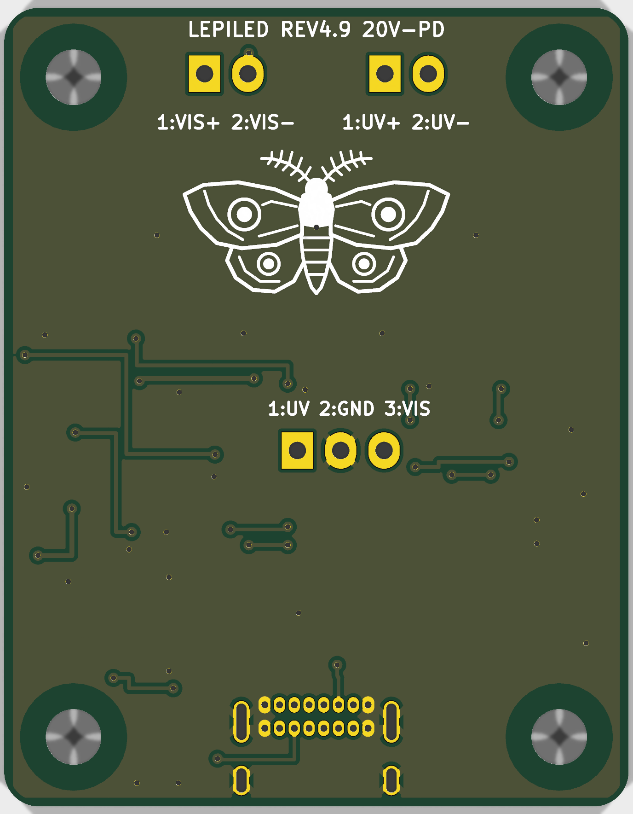

# LepiLED DIY Maxi Switch

**Open-source, fanless DIY moth lamp — `20 V` USB-C PD + dual buck drivers + `20 mm` Copper DTP LED stars**

*4× 365 nm UV-A · 2× 455 nm Royal Blue · 1× 528 nm Green · 1× 6200 K Cool White*

[Lamp Assembly](#whole-lamp-assembly) · [Driver PCB](#driver-pcb) · [Circuit Schematic](#circuit-schematic) · [Differences from Brehm (2017)](#differences-from-brehm-2017) · [Verification](#verification-summary) · [Build & BOM](#build--repository-map)

---

An open-source DIY implementation of Gunnar Brehm's *LepiLED* moth lamp ([Brehm, 2017, *Nota Lepidopterologica* 40(1): 87–108](https://doi.org/10.3897/nl.40.11887)), engineered for a compact, rugged, weatherproof, portable single-unit hobby build running straight off any `45 W+` USB-C PD laptop charger or `20 V` USB-C PD power bank. **Rev 4.6 ("Field Lantern")** weighs **`~521 g` FDM Black ASA** (`266.5 mm` tall) and pairs a clean industrial-design silhouette with full P0/P1 mechanical & thermal hardening: **one compact `5.1°` tapered matte-black ASA base (`Ø88.4 → Ø74.0 × 80.0 mm`)** with a `17.5 mm` recessed skirt hiding the bottom lid and bolts (eliminating `MECH-BASE-RING` and all exterior side holes), a **dry-bay internal core anchor** + **intact solid `R = 24.4 mm` core hubs**, a **coaxial 3D-printed 2-piece split cable clamp** passing an intact `90°` USB-C plug cleanly (eliminating the colliding `M20` gland), **ovality-tolerant `60 × 3.5 mm` soft VMQ50/60 radial shroud O-rings**, **brass `M2.5` & `M3` heat-set inserts**, a **lofted square-to-round `27°` rain roof** crowned by an `8 mm` chamfered finial and Signal-Orange hang-hole bushing, and a **matte-black sprayed `30 × 30 × 3 × 200 mm` Al core** protruding `63.0 mm` (`-13 to -16 °C` cooler in still air, passing **`16/16` Real-WPE modes at `22–30 °C` and `4/4` at `35 °C`!**).

## Whole Lamp Assembly

<table>
  <tr>
    <td align="center" width="50%">
      
       
      <b>3D Assembly (266.5 mm tall; ~521 g Black ASA)</b> — Compact 5.1° matte-black ASA tapered frustum base (80 mm tall) with recessed lid &amp; smooth 45°-arch cable portals, clear extruded XT PMMA window framing 8× warm copper LED stars, lofted square-to-round Ø84 mm rain roof, matte-black sprayed 30×30×3 Al chimney (63 mm exposed), chamfered finial cap, and Signal-Orange hang-hole bushing.
    </td>
    <td align="center" width="50%">
      
       
      <b>YZ Cross-Section</b> — Solid R=24.4 mm core hubs in both caps, dry-bay core anchor, ovality-tolerant 60×3.5 mm VMQ50/60 radial O-rings, horizontal <code>driver_pcb</code> (all 57 SMDs modeled) on M2.5 brass-insert standoffs, 90° USB-C plug + 7 mm strain relief clearing the 2-piece split cable clamp, and recessed bottom booted DPDT switch.
    </td>
  </tr>
</table>

## Driver PCB

<table>
  <tr>
    <td align="center" width="50%">
      
       
      <b>Driver PCB — Top (36 × 46 mm, 2L FR4 ENIG, JLCPCB Basic-Optimized PCBA)</b> AP33771C 20 V PD sink, 40 V DMN4035L load switch, hysteretic LM393B UVLO, dual AL8860WT-7 333 mA bucks.
    </td>
    <td align="center" width="50%">
      
       
      <b>Driver PCB — Bottom</b> Unbroken <code>B.Cu</code> power-stage GND plane, isolated <code>H1..H4</code> NPTH holes bolting onto M2.5 brass heat-set insert standoffs, mirrored pinout legends, and Emperor-moth back silkscreen.
    </td>
  </tr>
</table>

## Circuit Schematic

  
   
  Click the schematic to open the full vector <a href="circuit_design/schematic.pdf">schematic.pdf</a> (KiCad 9.0.8, 0 ERC violations, 75 unique RefDes).

## Differences from Brehm (2017)

Reference paper: **Brehm, G. (2017).** *A new LED lamp for the collection of nocturnal Lepidoptera and a spectral comparison of light-trapping lamps.* **Nota Lepidopterologica**, 40(1), 87–108. [doi:10.3897/nl.40.11887](https://doi.org/10.3897/nl.40.11887)

This DIY build retains the paper's 8-LED insect-tuned spectrum (`4× UV-A`, `2× Royal Blue`, `1× Green`, `1× Cool White` at two vertical levels) and UV-transmitting acrylic (`PMMA`) cylinder while making four practical departures from the 2017 prototype:

- **Fanless matte-black monolithic cooling & lofted rain roof:** Replaces the internal axial fan and gauze vents with a sealed clear extruded `XT PMMA` cylinder (`Ø60 × 54 × 3.0 × 115 mm`) on ovality-tolerant `60 × 3.5 mm` VMQ50/60 radial bore O-rings, a single stock `200 mm` `30 × 30 × 3 mm` Al core sprayed matte black (star pads masked, protruding `63.0 mm` with a Signal-Orange bushed `Ø8 mm` hanging hole and finial rain cap), an unbroken `Ø84 mm` square-to-round lofted `27°` rain roof, and an interior-mounted IP68 ePTFE breather vent preventing rain-quench fogging.
- **`20 V` USB-C PD + dual buck drivers + coaxial split cable clamp:** Replaces the `5–12 V` boost source with a `20 V` USB-C PD sink (`AP33771C`) and two `AL8860WT-7` constant-current buck drivers (`333 mA` per channel, `93.8%` efficiency), fed by a permanently captured `90°` USB-C PD cable sealed through a 3D-printed 2-piece split cable clamp (`MECH-CABLE-CLAMP`) that passes the intact `90°` plug effortlessly.
- **Recessed bottom-mounted dual-mode switch (`OFF / 4-UV / 8-ALL`):** Splits the 8 LEDs into independent 4S UV-A and 4S Visible strings controlled by a booted gold-contact `DPDT` toggle (`C&K 7211SYZBE`) recessed inside the compact `5.1°` tapered base skirt alongside tactile `0 / 1 / 2` midnight switch index ribs and a `28.3 mm` side-visible `D12` PD-status lightpipe.
- **Zero bare-SMD soldering & 8 support-free Black ASA prints:** Uses off-the-shelf pre-mounted `20 mm` Copper DTP LED stars (`R_sub ≈ 0.5 K/W`, bolted with `M3` screws + nylon washers), JLCPCB-assemblable `driver_pcb`, pre-crimped `22 AWG` JST-XH pigtails (passing straight through `9.0 × 7.5 mm` wire channels without de-pinning), `24 AWG` UV-stable silicone inter-star wire, brass `M2.5`/`M3` heat-set inserts, and 8 watertight support-free Black ASA prints.

## Verification Summary

| Domain | Verification Suite | Result | Report / Source |
|---|---|---|---|
| **Circuit & SPICE** | 6 `ngspice` benches + `2,565` datasheet corners + `2,000`-trial Monte Carlo | **15/15 PASS** (`0` corner fails, `100.0%` MC yield, `0` UVLO chatter) | [sim_summary.json](circuit_design/sim/outputs/sim_summary.json) |
| **Driver PCB** | KiCad 9.0.8 real-pin ERC + DRC (`--schematic-parity --severity-all`) + copper audits | **0 ERC, 0 DRC, 0 parity, 0 via-in-pad, 0 `B.Cu` power slots** | [driver_pcb.kicad_pcb](pcb_design/driver_pcb/driver_pcb.kicad_pcb) |
| **Thermal (Rev 4.6)** | Coupled network: XT PMMA (`Ø60×54`) + matte-black `30×30×3` core (`63 mm` chimney) + Cu DTP stars | **`16/16` Real-WPE PASS (`22–30 °C`) & `4/4` PASS at `35 °C` horiz!** (`22 °C` `T_j,UV = 55.8 °C`; `30 °C` horiz `T_j,UV = 63.0 / 71.6 °C`, `T_pcb = 60.3 / 70.4 °C`) | [thermal_summary.json](mechanical_design/thermal/thermal_summary.json) |
| **Mechanical CAD** | `38` param checks + `8` watertight STLs + `4` positive fastener-seat/hub gates + `84` kinematic sweeps + `210` B-Rep pairs (incl. `57` SMDs & `7 mm` USB-C strain relief) | **ALL PASS** (`0/210` collisions Nom/WC `60.6 mm` oval & `+2 mm`, `0.000 mm²` unsupported overhangs, **`~521 g` ASA**, **`266.5 mm` tall**) | [cad_verification.json](mechanical_design/cad/cad_verification.json) |
| **UK 1-Off BOM** | 1:1 RefDes (`75`) / PCBA (`61`) / Harness (`4`) / PCB (`1`) / Mech (`22`) parity | **PASS** (`£114.99` ex-VAT / `£137.99` inc-VAT all new incl. spray paint & brass inserts; **`£103.14` ex-VAT / `£123.77` inc-VAT** w/ owned screws, paste & spray) | [bom.csv](bom/bom.csv) |

<b>More Visuals — Thermal Emissivity Comparison, SPICE Waveforms &amp; 3D-Printed Parts</b>

 

  
   
  Steady-state UV junction temperatures at 30 °C still air (horizontal): spraying the full 30×30×3 Al core matte black (star pads masked) drops Tj,UV by 13.1–16.4 °C vs bare mill Al (or 8.5–10.4 °C if spraying only the protruding top chimney).

<table>
  <tr>
    <td align="center" width="50%">
      
       
      <b>SPICE Modes</b> — Clean transitions across OFF, 4-UV, and 8-ALL at 333 mA.
    </td>
    <td align="center" width="50%">
      
       
      <b>Support-Free Lofted Top Cap</b> — Unbroken Ø84 mm circular eaves lofted to an R=4 mm rounded-square collar, intact solid R=24.4 mm core hub, backed top silicone groove, and 4.6 mm solid M3 lock shoulders (0.000 mm² overhang upright).
    </td>
  </tr>
</table>

## Build & Repository Map

| Area | Key Files |
|---|---|
| **Start Here** | [ASSEMBLY_GUIDE.md](docs/ASSEMBLY_GUIDE.md) · [BOM.md](bom/BOM.md) · [DESIGN_DECISIONS.md](docs/DESIGN_DECISIONS.md) · [BLOCKERS.md](docs/BLOCKERS.md) |
| **Electronics & SPICE** | [schematic.pdf](circuit_design/schematic.pdf) · [ELECTRONICS_ARCHITECTURE.md](docs/ELECTRONICS_ARCHITECTURE.md) · [COMPONENT_IDS.csv](circuit_design/COMPONENT_IDS.csv) · [INTERFACE_CONTRACT.md](circuit_design/INTERFACE_CONTRACT.md) · [run_simulations.py](circuit_design/sim/run_simulations.py) |
| **Driver PCB & PCBA** | [PCB_SUMMARY.md](pcb_design/PCB_SUMMARY.md) · [driver_pcb_gerbers.zip](pcb_design/gerbers/driver_pcb/driver_pcb_gerbers.zip) · [assembly_map.pdf](pcb_design/driver_pcb/renders/assembly_map.pdf) · Full PCBA: [driver_pcb_bom_pcba.csv](pcb_design/driver_pcb_bom_pcba.csv) + [driver_pcb_cpl.csv](pcb_design/driver_pcb_cpl.csv) · Hybrid Budget PCBA: [driver_pcb_bom_pcba_hybrid.csv](pcb_design/driver_pcb_bom_pcba_hybrid.csv) + [driver_pcb_cpl_hybrid.csv](pcb_design/driver_pcb_cpl_hybrid.csv) + [driver_pcb_diy_hand_solder.csv](pcb_design/driver_pcb_diy_hand_solder.csv) |
| **3D Print & Mechanical** | [MECHANICAL_DESIGN.md](mechanical_design/MECHANICAL_DESIGN.md) · [CLEARANCE_VERIFICATION.md](mechanical_design/CLEARANCE_VERIFICATION.md) · [mech_cap_bot.step](mechanical_design/cad/mech_cap_bot.step) · [mech_lid_bot.step](mechanical_design/cad/mech_lid_bot.step) · [mech_cable_clamp.step](mechanical_design/cad/mech_cable_clamp.step) · [mech_core_anchor.step](mechanical_design/cad/mech_core_anchor.step) · [mech_cap_top.step](mechanical_design/cad/mech_cap_top.step) · [mech_plug_top.step](mechanical_design/cad/mech_plug_top.step) · [mech_hang_bushing.step](mechanical_design/cad/mech_hang_bushing.step) · [mech_drill_jig.step](mechanical_design/cad/mech_drill_jig.step) · [lepiled_assembly.step](mechanical_design/cad/lepiled_assembly.step) |
| **Datasheets & BOM** | [bom.csv](bom/bom.csv) · [MECH_PARTS.csv](mechanical_design/MECH_PARTS.csv) · [datasheets_summary.md](datasheets/datasheets_summary.md) |
