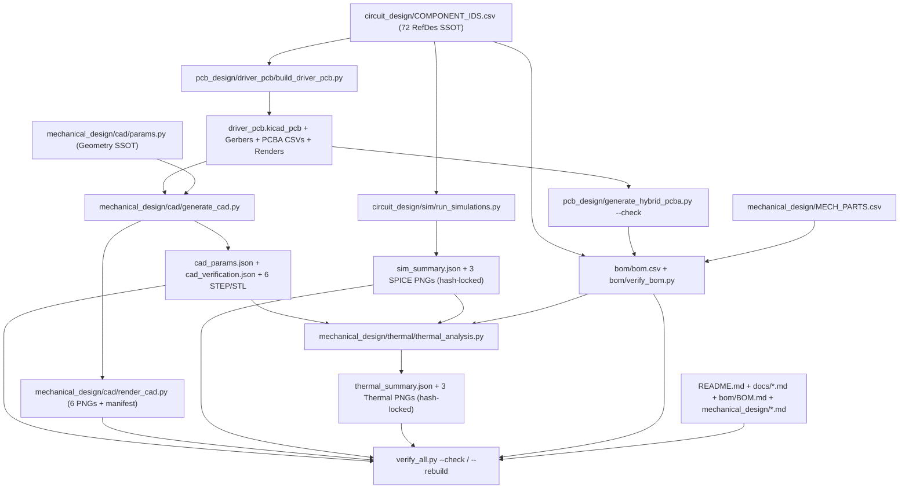

# LepiLED DIY Maxi Switch — Change Propagation & Verification Checklist

This document defines the mandatory procedure for making, propagating, and verifying any electrical, PCB, mechanical, thermal, figure, or BOM design change in this repository so that stale cross-references, mismatched BOM/thermal finishes, out-of-date plots, CAD geometry breaches, or BOM drift are caught automatically by [verify_all.py](../verify_all.py).

---

## 1. Single-Source-of-Truth (SSOT) Dependency DAG

Never copy derived numbers by hand between subsystems when a script can read the upstream JSON/CSV directly.



---

## 2. Change-Propagation Trigger Matrix

Whenever you modify any file in the left column, you **must** execute every downstream step in the right columns before committing.

| If You Change... | Downstream Artifacts to Regenerate | Automated Checks Required | Visual / Manual Checks Required |
|---|---|---|---|
| **Any electrical part, MPN, value, or RefDes** (`COMPONENT_IDS.csv`) | 1. `datasheets/datasheets_summary.{md,json}`<br>2. `build_driver_pcb.py` + `generate_hybrid_pcba.py`<br>3. `sim/netlists/*.cir` + `run_simulations.py` (3 SPICE PNGs + `sim_summary.json`)<br>4. `generate_cad.py` + `render_cad.py` (6 CAD PNGs + manifest)<br>5. `thermal_analysis.py` (3 thermal PNGs + `thermal_summary.json`)<br>6. `bom/bom.csv` + `bom/BOM.md`<br>7. Affected `docs/*.md` | `verify_all.py --rebuild` | Inspect `schematic.pdf`, `render_top.png`, `render_bottom.png`, `gerbv_bottom.png`, all 3 SPICE PNGs, and `assembly_section_xz.png`. Confirm LCSC stock & Basic/Extended status. |
| **PCB layout, footprint, silkscreen, or copper zones** (`build_driver_pcb.py`) | 1. `build_driver_pcb.py` (KiCad + Gerbers + PCBA CSVs + renders)<br>2. `generate_hybrid_pcba.py`<br>3. `generate_cad.py` + `render_cad.py` (syncs SMD 3D envelopes, `.kicad_pcb` hash & render manifest)<br>4. `pcb_design/PCB_SUMMARY.md` | `verify_all.py --check` | Inspect `render_top.png`, `render_bottom.png`, `gerbv_top.png`, `gerbv_bottom.png` (confirm clean H1..H4 keepouts & paste-free DNP pads). |
| **SPICE netlist, models, or simulation script** (`models.lib`, `*.cir`, `run_simulations.py`) | 1. `run_simulations.py` → `sim_summary.json` + all 3 hash-locked SPICE PNGs<br>2. `thermal_analysis.py` (reads `P_PCB` & `P_LED` from `sim_summary.json`)<br>3. `docs/ELECTRONICS_ARCHITECTURE.md`, `circuit_design/INTERFACE_CONTRACT.md` | `verify_all.py --check` | Visually inspect all 3 SPICE plots (`plot_nominal_modes.png`, `plot_uvlo_sweep.png`, `plot_fault_suite.png`) and all 3 thermal plots for accurate titles, legends, and curves. |
| **Mechanical CAD dimension, fastener, O-ring, or feature** (`params.py`, `generate_cad.py`, `render_cad.py`) | 1. `generate_cad.py` → `cad_params.json`, `cad_verification.json`, 6 print-ready `Z = 0` STEP/STL + assembly STEP<br>2. `xvfb-run -a render_cad.py` → all 6 CAD PNGs + `cad_render_manifest.json`<br>3. `thermal_analysis.py` (reads core protrusion, shroud window & bay geometry from `cad_params.json`)<br>4. `MECH_PARTS.csv` + `bom/bom.csv` + `bom/BOM.md` (if hardware or O-rings changed)<br>5. `docs/ASSEMBLY_GUIDE.md` (sync drill table to `cad_params.json`), `mechanical_design/*.md`, `README.md` | `verify_all.py --check` | **Mandatory:** Visually inspect all 6 CAD renders (`assembly_iso.png`, `assembly_section_xz.png`, `assembly_section_yz.png`, `cap_top_detail.png`, `cap_bot_detail.png`, `top_base_detail.png`) checking for thin walls, unintended holes, overhangs, or tight cable/plug bends. |
| **Thermal finish, core alloy/emissivity, shroud material, or ambient envelope** (`bom.csv` `MECH-HS-CORE` or `thermal_analysis.py`) | 1. `thermal_analysis.py` → `thermal_results.csv`, `thermal_summary.json`, and all 3 hash-locked thermal PNGs (`thermal_margins.png`, `thermal_ambient_sweep.png`, `thermal_network_comparison.png`)<br>2. `mechanical_design/MECHANICAL_DESIGN.md`, `README.md`, `docs/ASSEMBLY_GUIDE.md` | `verify_all.py --check` | Visually inspect all 3 thermal PNGs to verify dynamic titles/legends match `bom.csv` finish and check `T_j,UV <= 100 °C`, `T_shroud <= 75 °C`, `T_pcb_avg` & `T_j,U4 <= 70 °C` (`LM393`), and `T_plastic_max <= 80 °C` (White ASA derated continuous limit). |
| **Supplier, pack price, or BOM item** (`bom.csv`, `MECH_PARTS.csv`) | 1. `bom/verify_bom.py`<br>2. If material/finish changed (e.g., Al core finish), re-run `thermal_analysis.py` + update thermal docs<br>3. `bom/BOM.md`, `README.md`, `docs/BLOCKERS.md` | `verify_all.py --check` | Verify exact ex-VAT / inc-VAT totals, UK shipping table, and BOM ↔ thermal finish parity pass. |

---

## 3. Master Automated Verification Commands

Run from the repository root (`/home/alimuldal/src/lepiled`):

```bash
# Fast audit (verifies ALL gates, SHA-256 input & figure hashes, Gerber NPTH/DNP copper,
# BOM <-> thermal finish parity, BOM/Datasheet parity, and doc parity):
/tmp/lepiled-venv/bin/python verify_all.py --check

# Full end-to-end rebuild & audit (runs PCB -> SPICE -> CAD -> Renders -> Thermal -> BOM -> Checks):
/tmp/lepiled-venv/bin/python verify_all.py --rebuild
```

### Hard Gates Enforced Automatically by `verify_all.py`
1. **PCB Electrical, Fabrication & Render Integrity:**
   - KiCad ERC `--severity-all` = `0` violations.
   - KiCad DRC `--refill-zones --schematic-parity --severity-all` = `0` violations, `0` unconnected, `0` schematic parity issues.
   - Post-export RS-274X Gerber audit (`F_Cu.gbr`, `B_Cu.gbr`, `F_Paste.gbr`): `0` copper inside `r = 2.95 mm` of `H1..H4` M3 NPTH holes and `0` solder paste on DNP footprints (`D13`, `D14`).
   - `pcb_design/generate_hybrid_pcba.py --check` verifies 1:1 parity across `41` JLCPCB SMDs + `11` DIY parts + `2` DNP.
   - Verifies all 7 schematic & PCB render artifacts (`schematic.{png,pdf}`, `render_{top,bottom}.png`, `gerbv_{top,bottom}.png`, `assembly_map.pdf`) exist and are non-empty.
2. **Circuit & SPICE Freshness, Figure Hashes & Datasheet Limits:**
   - `sim_summary.json` `all_passed == True` (`16/16` checks, `0` corner failures, `100%` Monte Carlo yield).
   - Closed-form datasheet checks for `F1` breaking current (`< 50 A`) & `I²t` (`< 0.288 A²s`), `R7` 2512 pulse power (`< 600 W`), and `V_REF` startup speed (`R14*C16 < 0.5*R15*C15`).
   - SHA-256 `input_hashes` match current `COMPONENT_IDS.csv`, `models.lib`, `run_simulations.py`, and all 6 `.cir` netlists.
   - SHA-256 `output_figure_hashes` match all 3 generated SPICE plots (`plot_nominal_modes.png`, `plot_uvlo_sweep.png`, `plot_fault_suite.png`).
3. **Mechanical CAD Geometry, Sealing, B-Rep & Render Manifest Integrity:**
   - `cad_verification.json` `summary.overall_pass == True`: `55` parametric checks PASS, all `6` print-ready `Z = 0` STLs watertight & consistent winding, overhangs `<= 46°` outside allowed features.
   - `7` ray-cast wall-breach, bulkhead, and dimple-thickness gates + `3` positive fastener-seat bearing and intact 4-wall core-socket checks.
   - `124`-waypoint zero-interference kinematic insertion sweeps and `240` all-pairs B-Rep checks (`120` Nominal + `120` Worst-Case, `0.000000 mm³`).
   - SHA-256 `input_hashes` match `params.py` and `driver_pcb.kicad_pcb`; `cad_render_manifest.json` verifies `render_cad.py`, `cad_params.json`, `cad_verification.json`, and all 6 CAD PNG hashes.
4. **SSOT-Coupled Thermal Model, BOM Finish Parity & Figure Hashes:**
   - `thermal_summary.json` `input_hashes` match `cad_params.json`, `sim_summary.json`, and `thermal_analysis.py`; `output_figure_hashes` match all 3 thermal PNGs (`thermal_margins.png`, `thermal_ambient_sweep.png`, `thermal_network_comparison.png`).
   - **BOM ↔ Thermal Finish Parity Gate:** Verifies `bom/bom.csv`'s `MECH-HS-CORE` surface finish (bare mill vs anodized) matches `thermal_summary.json`'s `core_emissivity` and architecture title.
   - Enforces solver convergence & global energy balance (`< 1e-5 W`), `15–30 °C` bare-mill Real-WPE (`White ASA <= 80 °C` derated + `LM393 <= 70 °C`), `15–35 °C` bare-mill ASA structure, and `15–35 °C` upper-painted `ASA + LM393` pass gates.
5. **BOM & Datasheet Existence Parity:**
   - `bom/verify_bom.py` verifies `72` RefDes, `54` PCBA (`41` JLCPCB SMD + `11` DIY + `2` DNP), `4` Harness, `1` HASL PCB, `20` `MECH-*` IDs, penny-exact arithmetic, and that every `Datasheet_Ref` file in `COMPONENT_IDS.csv` exists on disk.
6. **Documentation Numeric & Stale-Reference Parity:**
   - Verifies `docs/ASSEMBLY_GUIDE.md` contains every exact core drill coordinate from `cad_params.json`.
   - Scans all active docs (including `docs/CHANGE_CHECKLIST.md`) against obsolete banned tokens.

---

## 4. Model-Simplification Judgment Rubric

Simplification is necessary in a hobby engineering project, provided the simplification does not hide a physical failure mode:

| Domain | Simplifications That ARE Acceptable | Simplifications That Are NEVER Acceptable |
|---|---|---|
| **Mechanical CAD & Collision Checks** | Bounding-box envelopes for SMD passives/ICs (with true XY footprints, rotations, and max datasheet heights read directly from `.kicad_pcb`); smooth pitch/major thread cylinders. | Shortening screws below BOM length or omitting inserts/washers; omitting connector housings, plugs, or cable strain reliefs; checking interference without checking positive wall/seat continuity; using JLCPCB CPL rotations as physical 3D angles. |
| **SPICE & Electrical Verification** | Behavioral macro-models for ICs (`AL8860`, `LM393`, `CH224A`) calibrated to datasheet specs; steady-state analytic corner sweeps paired with targeted time-domain fault benches. | Omitting real datasheet temperature coefficients (`TVS TBV1`), fuse `I²t` / interrupt current, or resistor single-pulse ratings; omitting quiescent/indicator losses when exporting `P_PCB` to thermal analysis; leaving figures out of sync with netlists. |
| **PCB & Gerber Verification** | Standard 2-layer `1.6 mm` FR4 stackup with perimeter `U3` thermal vias instead of plugged via-in-pad. | Running DRC without `--refill-zones --schematic-parity --severity-all`; trusting `.kicad_pcb` preview without auditing exported RS-274X Gerbers for NPTH keepouts and DNP paste suppression. |
| **Thermal Modeling** | Coupled 8-node lumped steady-state network using Churchill–Chu / Raithby–Hollands correlations and open-duct natural-draft momentum balance. | Hardcoding geometry (`L_chimney`, roof slope) or `P_PCB` instead of reading `cad_params.json` & `sim_summary.json`; leaving thermal emissivity or plot titles mismatched against `bom/bom.csv`; ignoring commercial `0..+70 °C` IC ratings or core-contacting polymer HDT. |
| **BOM & Costing** | Excluding workshop-owned tools/filament when clearly stated in scope. | Listing unverified placeholder URLs/prices for specialty parts or leaving live-ordered material changes unsynchronized with simulation assumptions. |
