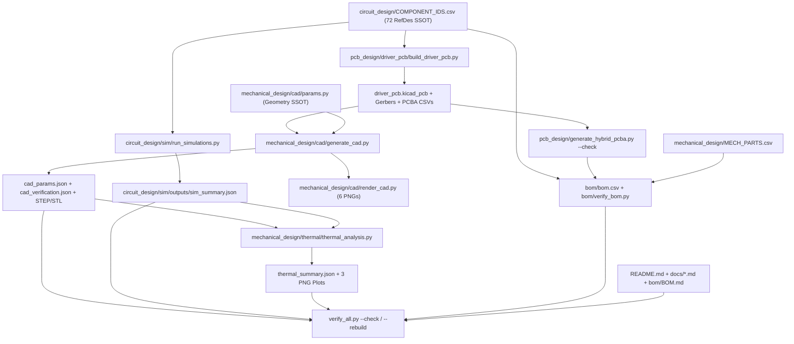

# LepiLED DIY Maxi Switch — Change Propagation & Verification Checklist

This document defines the mandatory procedure for making, propagating, and verifying any electrical, PCB, mechanical, thermal, or BOM design change in this repository. It was introduced in **Rev 4.8** so that stale cross-references, missing thermal updates, CAD geometry breaches, or BOM drift are caught automatically rather than during physical build.

---

## 1. Single-Source-of-Truth (SSOT) Dependency DAG

Never copy derived numbers by hand between subsystems when a script can read the upstream JSON/CSV directly.



---

## 2. Change-Propagation Trigger Matrix

Whenever you modify any file in the left column, you **must** execute every downstream step in the right columns before committing.

| If You Change... | Downstream Artifacts to Regenerate | Automated Checks Required | Visual / Manual Checks Required |
|---|---|---|---|
| **Any electrical part, MPN, value, or RefDes** (`COMPONENT_IDS.csv`) | 1. `datasheets/datasheets_summary.{md,json}`<br>2. `build_driver_pcb.py` + `generate_hybrid_pcba.py`<br>3. `sim/netlists/*.cir` + `run_simulations.py`<br>4. `generate_cad.py` + `render_cad.py`<br>5. `thermal_analysis.py`<br>6. `bom/bom.csv` + `bom/BOM.md`<br>7. Affected `docs/*.md` | `verify_all.py --rebuild` | Inspect `schematic.pdf`, `render_top.png`, `render_bottom.png`, `gerbv_bottom.png`, and `assembly_section_yz.png`. Confirm LCSC stock & Basic/Extended status. |
| **PCB layout, footprint, silkscreen, or copper zones** (`build_driver_pcb.py`) | 1. `build_driver_pcb.py` (KiCad + Gerbers + PCBA CSVs + renders)<br>2. `generate_hybrid_pcba.py`<br>3. `generate_cad.py` + `render_cad.py` (syncs SMD 3D envelopes & `.kicad_pcb` hash!)<br>4. `pcb_design/PCB_SUMMARY.md` | `verify_all.py --check` | Inspect `render_top.png`, `render_bottom.png`, `gerbv_top.png`, `gerbv_bottom.png` (confirm clean H1..H4 keepouts & paste-free DNP pads). |
| **SPICE netlist or power/fault assumptions** (`models.lib`, `*.cir`, `run_simulations.py`) | 1. `run_simulations.py` → `sim_summary.json` + 5 plots<br>2. **`thermal_analysis.py`** (reads `P_PCB` & `P_LED` from `sim_summary.json`!)<br>3. `docs/ELECTRONICS_ARCHITECTURE.md`, `circuit_design/INTERFACE_CONTRACT.md` | `verify_all.py --check` | Inspect SPICE plots & thermal margins plots. |
| **Mechanical CAD dimension, fastener, O-ring, or feature** (`params.py`, `generate_cad.py`) | 1. `generate_cad.py` → `cad_params.json`, `cad_verification.json`, 8 STEP/STL + assembly STEP<br>2. `render_cad.py` → all 6 CAD PNGs<br>3. **`thermal_analysis.py`** (reads core protrusion, shroud window & bulkhead from `cad_params.json`!)<br>4. `MECH_PARTS.csv` + `bom/bom.csv` + `bom/BOM.md` (if screw lengths, inserts, or O-ring IDs changed!)<br>5. `docs/ASSEMBLY_GUIDE.md` (sync drill table to `cad_params.json`), `mechanical_design/*.md`, `README.md` | `verify_all.py --check` | **Mandatory:** Visually inspect **all 6 CAD renders** (`assembly_iso.png`, `assembly_section_xz.png`, `assembly_section_yz.png`, `cap_top_detail.png`, `cap_bot_detail.png`, `lid_bot_detail.png`) looking explicitly for unintended holes, floating geometry, clipped ribs, or tight wire/plug bends. |
| **Thermal finish, paint scope, shroud material, or ambient envelope** (`thermal_analysis.py`) | 1. `thermal_analysis.py` → `thermal_results.csv`, `thermal_summary.json`, 3 PNG plots<br>2. `mechanical_design/MECHANICAL_DESIGN.md`, `README.md`, `docs/ASSEMBLY_GUIDE.md` | `verify_all.py --check` | Check `T_j,UV <= 100 °C`, `T_shroud <= 75 °C`, `T_bay_air <= 70 °C` (commercial IC spec) / `T_pcb <= 75 °C` (PETG) or `<= 95 °C` (ASA). |
| **Supplier, pack price, or BOM item** (`bom.csv`, `MECH_PARTS.csv`) | 1. `bom/verify_bom.py`<br>2. `bom/BOM.md`, `README.md` | `verify_all.py --check` | Verify exact ex-VAT / inc-VAT totals & multi-vendor UK shipping table match `verify_bom.py` output. |

---

## 3. Master Automated Verification Commands

Run from the repository root (`/home/alimuldal/src/lepiled`):

```bash
# Fast audit (verifies ALL gates, SHA-256 freshness hashes, Gerber NPTH/DNP copper,
# BOM/Datasheet parity, and Doc numeric parity without rebuilding CAD/renders):
/tmp/lepiled-venv/bin/python verify_all.py --check

# Full end-to-end rebuild & audit (runs PCB -> SPICE -> CAD -> Renders -> Thermal -> BOM -> Checks):
/tmp/lepiled-venv/bin/python verify_all.py --rebuild
```

### Hard Gates Enforced Automatically by `verify_all.py`
1. **PCB Electrical & Fabrication Integrity:**
   - KiCad ERC `--severity-all` = `0` violations.
   - KiCad DRC `--refill-zones --schematic-parity --severity-all` = `0` violations, `0` unconnected, `0` schematic parity issues.
   - Zero via-in-pad (`>= 0.25 mm` drill-to-SMD clearance) and `0` non-GND `B.Cu` segments under buck power stage.
   - **Post-export RS-274X Gerber Audit:** Parses `F_Cu.gbr`, `B_Cu.gbr`, and `F_Paste.gbr` to prove `0` copper inside `r = 2.70 mm` of `H1..H4` NPTH holes and `0` solder paste on DNP footprints (`D13`, `D14`).
   - `pcb_design/generate_hybrid_pcba.py --check` verifies 1:1 parity between canonical PCBA CSVs and the JLCPCB Full-SMD / DIY THT split.
2. **Circuit & SPICE Freshness & Datasheet Limits:**
   - `sim_summary.json` `all_passed == True` (`16/16` checks, `0` corner failures, `100%` Monte Carlo yield).
   - Closed-form datasheet checks for `F1` breaking current (`< 50 A`) & `I²t` (`< 0.288 A²s`), `R7` 2512 pulse power (`< 600 W`), and `V_REF` startup speed (`R14*C16 < 0.5*R15*C15`).
   - SHA-256 `input_hashes` match current `COMPONENT_IDS.csv`, `models.lib`, and all 6 `.cir` netlists.
3. **Mechanical CAD Geometry, Sealing & B-Rep Integrity:**
   - `cad_verification.json` `summary.overall_pass == True`: all parametric checks PASS, all 8 STLs watertight & consistent winding, all overhangs `<= 46°` (`< 1.0 mm²`).
   - **Exterior-to-Interior Ray-Cast Wall-Breach Gate:** Verifies `0` roof holes in `MECH-CAP-TOP`, `2/2` sealed solid roofs above blind `MECH-LID-BOT` clamp inserts, and `0` side breaches in `MECH-CAP-BOT`'s dry-bay wall.
   - Positive fastener-seat bearing & 4-wall intact core sockets.
   - Zero-interference kinematic sweeps (including sliding the **entire** lid + PCB + 15 mm 90° USB-C plug straight up into `MECH-CAP-BOT`).
   - `0` nonzero B-Rep intersections across **all 105 Nominal + 105 Worst-Case pairs** including **all 14 brass inserts, exact full-length BOM screws, all 48 SMDs read directly from `driver_pcb.kicad_pcb`, and the 15 mm USB-C plug + 7 mm strain relief**.
   - SHA-256 `input_hashes` match current `params.py` and `driver_pcb.kicad_pcb`.
4. **SSOT-Coupled Thermal Model Freshness:**
   - `thermal_summary.json` `input_hashes` match current `cad_params.json`, `sim_summary.json`, and `thermal_analysis.py`.
   - `rev48_15_30C_real_modes_all_pass == True`.
5. **BOM & Datasheet Existence Parity:**
   - `bom/verify_bom.py` verifies `72` RefDes, `54` PCBA (`48` JLCPCB SMD + `4` DIY THT + `2` DNP), `4` Harness, `1` ENIG PCB, `23` `MECH-*` IDs, penny-exact arithmetic, **and that every `Datasheet_Ref` file in `COMPONENT_IDS.csv` exists on disk**.
6. **Documentation Numeric & Stale-Reference Parity:**
   - Verifies that `docs/ASSEMBLY_GUIDE.md` contains **every exact core drill coordinate** from `cad_params.json`'s `drill_guide_from_core_bot_mm`.
   - Scans key active docs (`README.md`, `docs/ASSEMBLY_GUIDE.md`, `docs/ELECTRONICS_ARCHITECTURE.md`, `docs/BLOCKERS.md`, `pcb_design/PCB_SUMMARY.md`, `mechanical_design/MECHANICAL_DESIGN.md`, `mechanical_design/CLEARANCE_VERIFICATION.md`, `circuit_design/INTERFACE_CONTRACT.md`, `bom/BOM.md`) to fail if banned obsolete Rev ≤4.7 parts reappear (`MF-MSMF110/33X`, `SRN6045-680M`, `Dow 7091`, `0805W8F100KT5E`, `AP33771C`, `DMN4035L`).

---

## 4. Model-Simplification Judgment Rubric

Simplification is necessary in a hobby engineering project, **provided the simplification does not hide a physical failure mode**. Use this rubric before simplifying any simulation, CAD solid, or verification script:

| Domain | Simplifications That ARE Acceptable (Good Judgment) | Simplifications That Are NEVER Acceptable (Must Model Faithfully) |
|---|---|---|
| **Mechanical CAD & Collision Checks** | • Bounding-box envelopes for SMD passives/ICs (with true XY footprints, rotations, and max datasheet heights read directly from `.kicad_pcb`).<br>• Modeling threads as smooth pitch/major cylinders.<br>• Omitting cosmetic fillets inside non-mating interior voids. | • **Shortening screws below BOM length** or omitting threaded brass inserts (hides screw-to-insert collisions).<br>• **Omitting connector housings, plugs, or cable strain reliefs** (hides blind mating / wall crashes).<br>• **Checking only interference without checking positive wall/seat continuity** (hides holes punched through roofs/walls).<br>• Using JLCPCB CPL rotation-compensated angles as physical 3D rotations. |
| **SPICE & Electrical Verification** | • Behavioral macro-models for ICs (`AL8860`, `LM393`, `CH224A`) calibrated to datasheet specs.<br>• Steady-state analytic corner sweeps paired with targeted time-domain SPICE fault benches.<br>• Omitting trace parasitics on slow DC logic nets. | • **Omitting real datasheet temperature coefficients** on surge clamps (`TVS TBV1`), fuse `I²t` / interrupt current, or resistor single-pulse power curves.<br>• **Leaving out quiescent/indicator/leakage losses** (`LM393`, `D12`, `SS34`) when exporting `P_PCB` to thermal analysis.<br>• Using schematic pin types of `passive` everywhere to silence ERC. |
| **PCB & Gerber Verification** | • Standard 2-layer `1.6 mm` FR4 stackup with perimeter `U3` thermal vias instead of plugged via-in-pad.<br>• Standard KiCad 3D procedural renders instead of bespoke STEP models for generic 0603 passives. | • **Running DRC without `--refill-zones --schematic-parity --severity-all`** (misses stale zone copper invading NPTH holes and schematic/PCB drift).<br>• **Trusting `kicad_pcb` preview without auditing exported RS-274X Gerbers** for NPTH keepouts and DNP paste suppression. |
| **Thermal Modeling** | • Coupled 5-node lumped steady-state network using Churchill–Chu / Raithby–Hollands correlations instead of full 3D CFD.<br>• Ignoring transient dusk solar load for a nocturnal-only open-space moth lamp.<br>• Modeling open-space hanging Fresnel reflection (`~14%` optical re-absorption) instead of enclosed reflective bucket-trap ray-tracing. | • **Hardcoding geometry (`L_chimney`) or `P_PCB` instead of reading `cad_params.json` & `sim_summary.json`.**<br>• **Assuming view factor `F_amb = 1.0`** when rain eaves visibly shade the chimney.<br>• **Ignoring commercial `0..+70 °C` IC ambient ratings** inside a sealed plastic bay. |
| **BOM & Costing** | • Excluding workshop-owned consumables/tools the builder already has (e.g., workshop 3D-printer filament, UV400 glasses, O-ring grease, existing M3 assortment) when clearly noted in scope. | • **Listing unverified placeholder URLs/prices** for specialty parts (e.g., Royal Blue/Green stars or PMMA-safe silicone) or hiding multi-vendor UK shipping surcharges from the build summary. |
